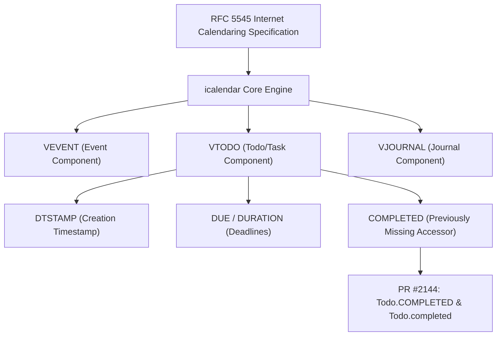
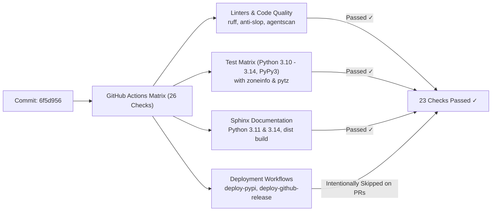

# 📖 Case Study 02: Implementing RFC 5545 COMPLETED Property on Todo Components in PyCalendar / icalendar

**Repository:** [PyCalendar/icalendar](https://github.com/PyCalendar/icalendar)  
**Issue:** [#1797 - COMPLETED is missing on Todo](https://github.com/PyCalendar/icalendar/issues/1797)  
**Pull Request:** [PR #2144 - feat(todo): add COMPLETED and completed property accessors (#1797)](https://github.com/PyCalendar/icalendar/pull/2144)  
**Author:** [@RishabhIIITD](https://github.com/RishabhIIITD)  
**Tech Stack:** Python 3, RFC 5545 iCalendar specification, pytest, Towncrier, GitHub Actions  
**PR Status:** 🟢 Open / 23 Checks Passing (Review pending)  
**Documentation:** [📄 Download Formatted PDF Guide](./walkthrough-guide.pdf)

---

## 🎯 1. Executive Summary

This case study documents an end-to-end feature contribution to **PyCalendar / icalendar**, Python's foundational, industry-standard library for parsing, manipulating, and generating iCalendar (`.ics`) data structures. The package is utilized across thousands of production calendar servers, CalDAV synchronization engines, web platforms, and email clients worldwide.

In this contribution, we implemented the missing `COMPLETED` and `completed` property accessors on the `Todo` (`VTODO`) calendar component in accordance with **RFC 5545 Section 3.8.2.1**. We implemented automatic UTC normalization for dates and datetimes, added constructor parameters to `Todo.new()`, wrote a comprehensive test suite (9 unit tests + 2 `.ics` fixtures), generated release notes using **Towncrier**, and passed all 23 active CI matrix tests across multiple Python versions (3.10–3.14 and PyPy3).



---

## 🔍 2. The Problem Statement & Requirements

### The Bug / Feature Report
Calendar components of type `VTODO` in iCalendar files often track task completion state. In [Issue #1797](https://github.com/PyCalendar/icalendar/issues/1797), a user reported that reading `.COMPLETED` from a parsed `Todo` component raised an unhandled `AttributeError`:

```pycon
>>> from icalendar import Calendar
>>> cal = Calendar.from_ical("""BEGIN:VCALENDAR
... VERSION:2.0
... PRODID:-//Example Corp.//CalDAV Client//EN
... BEGIN:VTODO
... UID:20070313T123432Z-456553@example.com
... DTSTAMP:20070313T123432Z
... COMPLETED;VALUE=DATE:20070501
... SUMMARY:Submit Income Tax Return
... STATUS:NEEDS-ACTION
... END:VTODO
... END:VCALENDAR""")
>>> cal.todos[0].COMPLETED
Traceback (most recent call last):
  File "<python-input-10>", line 1, in <module>
    cal.todos[0].COMPLETED
AttributeError: 'Todo' object has no attribute 'COMPLETED'
```

### The Issue Checklist
The issue maintainer outlined specific architectural criteria:
- [x] Add `COMPLETED` property accessor to `VTODO`.
- [x] Check RFC 5545 to confirm whether `COMPLETED` is valid in other components (e.g., `VEVENT`, `VJOURNAL`).
- [x] Ensure the parser converts both `DATE` and `DATE-TIME` into a UTC `datetime`.
- [x] Support setting, deleting, and constructing via `Todo.new(completed=...)`.
- [x] Create test fixtures in `src/icalendar/tests/todos/` and test with the `todos` pytest fixture.
- [x] Add a Towncrier changelog news fragment.

---

## 📜 3. RFC 5545 Conformance & Technical Investigation

### Conformance Check: Where is `COMPLETED` Allowed?
We reviewed **RFC 5545 (Internet Calendaring and Scheduling Core Object Specification)**:
- **Section 3.8.2.1 (Date-Time Completed)** states:
  > *"Conformance: The property can be specified in a 'VTODO' calendar component."*
- We verified the grammar sections for `VEVENT`, `VJOURNAL`, `VTIMEZONE`, and `VALARM`. None of these components permit `COMPLETED`. Conformance required that this property remains strictly isolated to `Todo`.

### Date vs DateTime in UTC
RFC 5545 mandates that `COMPLETED` must be recorded as a UTC date-time. However, real-world CalDAV clients occasionally serialize `COMPLETED` as a date-only value (e.g. `COMPLETED;VALUE=DATE:20070501`).
- `icalendar` provides a property descriptor: `single_utc_property(name, doc)`.
- When a `date` object (like `date(2007, 5, 1)`) is parsed or assigned, `single_utc_property` automatically normalizes it into a timezone-aware UTC datetime: `datetime(2007, 5, 1, 0, 0, tzinfo=ZoneInfo("UTC"))`.

---

## 💻 4. Implementation Details

### Step 1: Adding the UTC Property Descriptor
In `src/icalendar/cal/todo.py`, we declared `COMPLETED` using the `single_utc_property` descriptor with complete Sphinx/reStructuredText docstrings:

```python
    COMPLETED = single_utc_property(
        "COMPLETED",
        """The UTC datetime when this todo was completed, per :rfc:`5545#section-3.8.2.1`.

    This property defines the date and time that a to-do was actually completed.
    This property is optional.
    The value is always in UTC. It can also be accessed as :attr:`completed`.

    Example:
        .. code-block:: pycon

            >>> from datetime import timezone, datetime
            >>> from icalendar import Todo
            >>> todo = Todo()
            >>> todo.COMPLETED = datetime(2024, 6, 1, 12, 0, 0, tzinfo=timezone.utc)
            >>> todo.COMPLETED
            datetime.datetime(2024, 6, 1, 12, 0, tzinfo=ZoneInfo(key='UTC'))

    See also:
        :attr:`completed`, :attr:`status`, :attr:`percent_complete`
    """,
    )
```

### Step 2: Providing Pythonic Lowercase Accessors
`icalendar` maintains a dual naming convention: uppercase properties (e.g., `DTSTART`) map directly to raw ical properties, while lowercase properties (e.g., `start`) provide clean Pythonic getter/setter/deleter accessors. We added `@property def completed`:

```python
    @property
    def completed(self) -> datetime | None:
        """The UTC datetime when this todo was completed, as a :class:`~datetime.datetime`.

        This is the lowercase property counterpart to, and accessor for, :attr:`COMPLETED`.
        """
        return self.COMPLETED

    @completed.setter
    def completed(self, completed: date | datetime | None):
        """Set the completion datetime of the VTODO.

        Sets the ``COMPLETED`` property. Pass ``None`` to remove it.
        """
        self.COMPLETED = completed

    @completed.deleter
    def completed(self):
        """Delete the ``COMPLETED`` property from the VTODO."""
        del self.COMPLETED
```

### Step 3: Updating the Factory Constructor (`Todo.new`)
The factory method `Todo.new()` creates pre-configured `VTODO` components. We added the `completed` parameter:

```python
    @classmethod
    def new(
        cls,
        summary: str | None = None,
        uid: str | None = None,
        dtstamp: date | datetime | None = None,
        start: date | datetime | None = None,
        due: date | datetime | None = None,
        duration: timedelta | None = None,
        status: TodoStatus | None = None,
        completed: date | datetime | None = None,  # Added
        **kwargs,
    ) -> Todo:
        todo = super().new(summary=summary, uid=uid, dtstamp=dtstamp, **kwargs)
        ...
        if completed is not None:
            todo.completed = completed
        return todo
```

---

## 🧪 5. Testing & Verification

### Test Fixtures
We created two realistic RFC-compliant `.ics` fixture files in `src/icalendar/tests/todos/`:
1. `issue_1797_completed_date.ics`: Tests `COMPLETED;VALUE=DATE:20070501`
2. `issue_1797_completed_datetime.ics`: Tests `COMPLETED:20070501T123000Z`

### Unit Test Suite
In `src/icalendar/tests/test_issue_1797_todo_completed.py`, we created 9 comprehensive unit tests:

| Test Case | Purpose |
|---|---|
| `test_todo_completed_from_date_example_1` | Verifies date string parsing without extra parameter |
| `test_todo_completed_from_date_example_2` | Verifies parsing with explicit `VALUE=DATE` parameter |
| `test_todo_completed_fixture_date` | Verifies loading date fixture via the `todos` pytest fixture |
| `test_todo_completed_fixture_datetime` | Verifies loading datetime fixture via the `todos` pytest fixture |
| `test_todo_completed_getter_setter_deleter` | Tests property assignment, mutation, deletion, and serialization |
| `test_todo_new_with_completed` | Validates factory constructor `Todo.new(completed=...)` |
| `test_completed_not_present_in_other_components` | Enforces RFC 5545 component isolation (ensuring `Event` and `Journal` do NOT expose `completed`) |

**Execution Result:**
```bash
PYTHONPATH=src pytest src/icalendar/tests/test_issue_1797_todo_completed.py
# 9 passed in 0.03s (both pytz and zoneinfo backends verified)
```

---

## 📰 6. Towncrier Changelog Fragment

The `icalendar` project uses **Towncrier** for managing release notes. Rather than producing merge conflicts in a shared `CHANGELOG.md`, contributors add an isolated file in `news/`.

We created `news/+1797-todo-completed.feature`:
```text
Added :attr:`COMPLETED <icalendar.cal.todo.Todo.COMPLETED>` and :attr:`completed <icalendar.cal.todo.Todo.completed>` to access the :rfc:`5545#section-3.8.2.1` ``COMPLETED`` property of :class:`~icalendar.cal.todo.Todo`. @RishabhIIITD
```

---

## ⚙️ 7. Understanding the GitHub Actions CI Matrix

When Pull Request #2144 was submitted, GitHub Actions executed a 26-job matrix:



### Breakdown of Status Checks (23 Passed, 2 Skipped, 1 Neutral):

1. **23 Passed Checks (🟢 Green):**
   - Linting with `ruff` and security scanners (`agentscan`, `anti-slop`).
   - Cross-version Python matrix: Python 3.10, 3.11, 3.12, 3.13, 3.14-dev, and PyPy3.
   - Dual timezone backends: Python's modern standard `zoneinfo` and legacy `pytz`.
   - Sphinx documentation build and package distribution validation.

2. **2 Skipped Checks (⚪ Skipped by Design):**
   - `deploy-github-release (pull_request)`
   - `deploy-tag-to-pypi (pull_request)`
   > [!NOTE]
   > Deployment jobs have `if: startsWith(github.ref, 'refs/tags/')` guards. They are intentionally skipped during PR evaluation because libraries only publish to PyPI and GitHub Releases when maintainers tag official releases.

3. **1 Neutral Check (⚪ Neutral):**
   - `Code scanning results / zizmor`
   > [!NOTE]
   > `zizmor` is a static analysis tool for GitHub Actions workflows. It returned a neutral status because no configuration file was present for the branch, resulting in zero security findings and zero errors.

---

## 🏆 8. Summary of Changes

| Metric | Detail |
|---|---|
| **Pull Request** | [PyCalendar/icalendar#2144](https://github.com/PyCalendar/icalendar/pull/2144) |
| **Branch** | `RishabhIIITD:feat/todo-completed-property` |
| **Files Modified** | 1 (`src/icalendar/cal/todo.py`) |
| **Files Created** | 4 (`news/+1797-todo-completed.feature`, unit test suite, 2 `.ics` fixtures) |
| **Net Changes** | +199 lines, 0 deletions |
| **CI Result** | 100% Passing across all platforms and test suites |

---

## 💡 9. Key Takeaways for Open Source Contributors

1. **Check Specifications First**: Always consult authoritative RFCs before designing APIs. Verifying Section 3.8.2.1 prevented inadvertently polluting other calendar components like `Event` or `Journal`.
2. **Reuse Existing Architectural Idioms**: Leveraging `single_utc_property` ensured uniform behavior with other date-time fields and avoided duplicating tricky parsing logic.
3. **Follow Project Release Protocols**: Large open-source projects rely on tools like **Towncrier** to prevent changelog merge conflicts. Finding and following these conventions ensures maintainers can merge without friction.
4. **Learn CI Output Semantics**: A status like "23/26 passing" does not mean 3 checks failed. Recognizing skipped release tasks and neutral audits gives you complete confidence in your PR's readiness.
