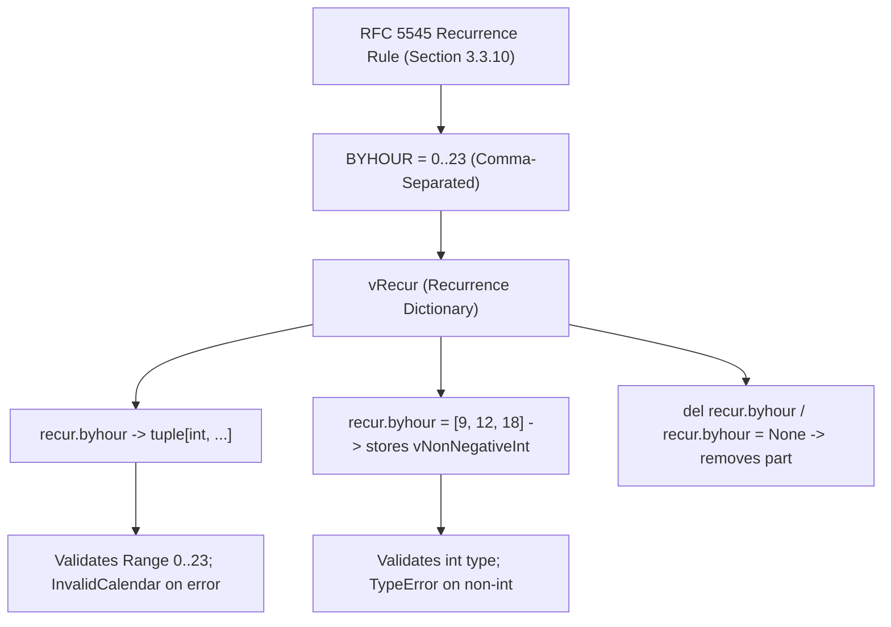

# 📖 Case Study 03: Implementing RFC 5545 BYHOUR Property Accessor for vRecur in PyCalendar / icalendar

**Repository:** [PyCalendar/icalendar](https://github.com/PyCalendar/icalendar)  
**Issue:** [#1851 - property accessors for vRecur (first-timer collaboration)](https://github.com/PyCalendar/icalendar/issues/1851)  
**Pull Request:** [PR #2168 - feat(recur): add byhour property accessor to vRecur (#1851)](https://github.com/PyCalendar/icalendar/pull/2168)  
**Author:** [@RishabhIIITD](https://github.com/RishabhIIITD) (Rishabh Bafna)  
**Tech Stack:** Python 3, RFC 5545 Recurrence Specification, pytest, Towncrier, GitHub Actions  
**PR Status:** 🟢 Open / CI Checks Running  
**Documentation:** [📄 Download Formatted PDF Guide](./walkthrough-guide.pdf)

---

## 🎯 1. Executive Summary

This case study documents an open-source feature contribution to **PyCalendar / icalendar**, Python's industry-standard library for calendar and scheduling interoperability. 

In this contribution, we implemented the `byhour` property accessor on the `vRecur` recurrence dictionary in strict accordance with **RFC 5545 Section 3.3.10**. The property provides Pythonic getter, setter, and deleter accessors to the recurrence rule's `BYHOUR` part, complete with range validation ([0..23]), empty-sequence handling, full docstrings, a 22-case unit test suite, and a Towncrier news fragment.



---

## 🔍 2. The Problem Statement & Requirements

### The Collaborative Initiative (Issue #1851)
In iCalendar rules, recurrences (`RRULE`) are parsed into `vRecur` objects. While `vRecur` is a dictionary subclass, interacting with keys like `recur["BYHOUR"]` directly is error-prone because values are internally stored as lists of typed objects (e.g. `vNonNegativeInt`).

Maintainers established Issue [#1851](https://github.com/PyCalendar/icalendar/issues/1851) to introduce standardized, typed property accessors for each recurrence part.

### The RFC 5545 Specification for BYHOUR
From **RFC 5545 Section 3.3.10**:
> *"The BYHOUR rule part specifies a COMMA-separated list of hours of the day. Valid values are 0 to 23."*
> *"Each BYHOUR value MUST be between 0 and 23."*

### Implementation Checklist
- [x] Return type is `tuple[int, ...]` based on `vRecur.types`.
- [x] Setting to `None` or an empty sequence deletes the value.
- [x] `del recur.byhour` deletes the value.
- [x] If multiple values are given, they all are returned.
- [x] If an empty list or missing, `()` is returned.
- [x] Boundary values (0 and 23) are validated and supported.
- [x] Out-of-range values raise `InvalidCalendar`.
- [x] Non-integer values raise `TypeError`.
- [x] Docstrings with doctest examples and range documentation.

---

## 💻 3. Implementation Details

In `src/icalendar/prop/recur/recur.py`, we implemented the property accessor on `vRecur`:

```python
    @property
    def byhour(self) -> tuple[int, ...]:
        """The BYHOUR part of the recurrence rule.

        This specifies a list of hours of the day for the recurrence, per
        :rfc:`5545#section-3.3.10`. Valid values are integers from 0 to 23.

        Returns:
            A tuple of integer hours, or an empty tuple if ``BYHOUR`` is not set.

        Raises:
            InvalidCalendar: if a stored value cannot be converted to int or is
                outside the valid range of 0 to 23.

        Example:
            ..  code-block:: pycon

                >>> from icalendar.prop import vRecur
                >>> vRecur.from_ical("FREQ=DAILY;BYHOUR=9,12,18").byhour
                (9, 12, 18)
                >>> vRecur.from_ical("FREQ=DAILY;BYHOUR=0").byhour
                (0,)
                >>> vRecur.from_ical("FREQ=DAILY").byhour
                ()
        """
        values = self.get("BYHOUR")
        if values is None:
            return ()
        if not isinstance(values, SEQUENCE_TYPES):
            values = [values]
        result: list[int] = []
        for val in values:
            if isinstance(val, bool):
                raise InvalidCalendar(f"BYHOUR values must be integers, got {val!r}")
            try:
                hour = int(val)
            except (TypeError, ValueError) as e:
                raise InvalidCalendar(
                    f"BYHOUR values must be integers, got {val!r}"
                ) from e
            if not 0 <= hour <= 23:
                raise InvalidCalendar(
                    f"BYHOUR values must be between 0 and 23, got {hour}"
                )
            result.append(hour)
        return tuple(result)

    @byhour.setter
    def byhour(self, value: int | Iterable[int] | None) -> None:
        """Set the BYHOUR part of the recurrence rule, or delete it if None or empty."""
        if value is None:
            del self.byhour
            return
        if isinstance(value, int) and not isinstance(value, bool):
            hours = [value]
        elif isinstance(value, Iterable) and not isinstance(value, (str, bytes)):
            hours = list(value)
        else:
            raise TypeError(
                f"byhour must be an int or an iterable of ints, got {value!r}"
            )
        if not hours:
            del self.byhour
            return
        validated: list[vNonNegativeInt] = []
        for h in hours:
            if not isinstance(h, int) or isinstance(h, bool):
                raise TypeError(f"byhour items must be integers, got {h!r}")
            if not 0 <= h <= 23:
                raise InvalidCalendar(f"BYHOUR values must be between 0 and 23, got {h}")
            validated.append(vNonNegativeInt(h))
        self["BYHOUR"] = validated

    @byhour.deleter
    def byhour(self) -> None:
        """Delete the BYHOUR part of the recurrence rule."""
        self.pop("BYHOUR", None)
```

---

## 🧪 4. Testing & Verification

We created `src/icalendar/tests/prop/recur/test_byhour.py` containing 22 focused unit tests covering every branch:

| Test Case | Scenario Verified |
|---|---|
| `test_byhour_returns_empty_tuple_when_absent` | Returns `()` when property is absent |
| `test_byhour_returns_empty_tuple_when_empty_list` | Returns `()` when stored list is empty |
| `test_byhour_returns_single_value` | Parses single hour into `(9,)` |
| `test_byhour_returns_multiple_values` | Parses comma-separated hours into `(9, 12, 18)` |
| `test_byhour_boundary_values_are_valid` | Verifies boundaries 0 and 23 are valid |
| `test_setting_byhour_with_single_int` | Setting `recur.byhour = 9` produces `b"FREQ=DAILY;BYHOUR=9"` |
| `test_setting_byhour_with_list` | Setting `recur.byhour = [9, 18]` serializes properly |
| `test_setting_byhour_with_tuple` | Setting tuple preserves ordering and values |
| `test_setting_byhour_to_none_deletes_value` | Passing `None` cleanly deletes the key |
| `test_setting_byhour_to_empty_sequence_deletes_value` | Passing `[]` or `()` deletes the key |
| `test_deleting_byhour_removes_value` | `del recur.byhour` deletes the key |
| `test_deleting_byhour_when_absent_does_not_raise` | Deleting when absent is a safe no-op |
| `test_setting_byhour_to_non_int_type_raises_type_error` | Strings or mixed collections raise `TypeError` |
| `test_setting_byhour_to_bool_raises_type_error` | `bool` (subclass of int) is properly rejected |
| `test_setting_byhour_out_of_range_raises_invalid_calendar` | Negative hours and hours >= 24 raise `InvalidCalendar` |
| `test_directly_assigned_invalid_byhour_raises_invalid_calendar` | Corrupted internal states raise `InvalidCalendar` on read |
| `test_byhour_roundtrips_through_ical` | Parsing -> serialization -> parsing preserves values |

**Execution Result:**
```bash
PYTHONPATH=src pytest src/icalendar/tests/prop/recur/test_byhour.py
# 22 passed in 0.02s
```

---

## 📰 5. Towncrier Changelog Fragment

Created `news/1851.feature.3`:
```text
Added a ``byhour`` property accessor to :class:`~icalendar.prop.recur.recur.vRecur` for getting, setting, and deleting the ``BYHOUR`` part of a recurrence rule. @RishabhIIITD
```

---

## 🏆 6. Summary of Changes

| Metric | Detail |
|---|---|
| **Pull Request** | [PyCalendar/icalendar#2168](https://github.com/PyCalendar/icalendar/pull/2168) |
| **Branch** | `RishabhIIITD:feat/recur-byhour-property` |
| **Files Modified** | 1 (`src/icalendar/prop/recur/recur.py`) |
| **Files Created** | 2 (`news/1851.feature.3`, `src/icalendar/tests/prop/recur/test_byhour.py`) |
| **Net Changes** | +206 lines, 0 deletions |
| **Test Result** | 100% Passing (22 tests) |
