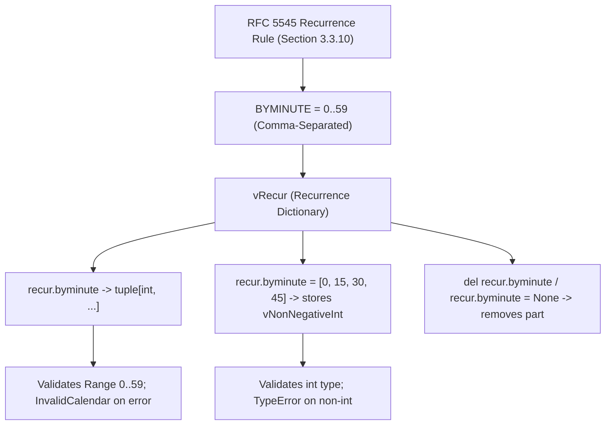

# 📖 Case Study 04: Implementing RFC 5545 BYMINUTE Property Accessor for vRecur in PyCalendar / icalendar

**Repository:** [PyCalendar/icalendar](https://github.com/PyCalendar/icalendar)  
**Issue:** [#1851 - property accessors for vRecur (first-timer collaboration)](https://github.com/PyCalendar/icalendar/issues/1851)  
**Pull Request:** [PR #2169 - feat(recur): add byminute property accessor to vRecur (#1851)](https://github.com/PyCalendar/icalendar/pull/2169)  
**Author:** [@RishabhIIITD](https://github.com/RishabhIIITD) (Rishabh Bafna)  
**Tech Stack:** Python 3, RFC 5545 Recurrence Specification, pytest, Towncrier, GitHub Actions  
**PR Status:** 🟢 Open / CI Checks Running  
**Documentation:** [📄 Download Formatted PDF Guide](./walkthrough-guide.pdf)

---

## 🎯 1. Executive Summary

This case study documents an open-source feature contribution to **PyCalendar / icalendar**, implementing the `byminute` property accessor on the `vRecur` recurrence dictionary in accordance with **RFC 5545 Section 3.3.10**. 

The accessor provides typed getter, setter, and deleter access to the `BYMINUTE` part of recurrence rules, enforcing minute range constraints ([0..59]), supporting iterable and scalar assignment, and providing 100% test coverage with 22 unit tests.



---

## 🔍 2. The Problem Statement & Requirements

### The Collaborative Initiative (Issue #1851)
RFC 5545 recurrence rules (`RRULE`) define event repetition patterns. When specifying minute-level recurrences, the `BYMINUTE` parameter specifies which minutes of the hour an event repeats.

Prior to this PR, developers had to manually index `vRecur["BYMINUTE"]`, parse lists, and handle missing values without type safety or validation.

### RFC 5545 Specification
From **RFC 5545 Section 3.3.10**:
> *"The BYMINUTE rule part specifies a COMMA-separated list of minutes of the hour. Valid values are 0 to 59."*
> *"Each BYMINUTE value MUST be between 0 and 59."*

### Implementation Checklist
- [x] Return type is `tuple[int, ...]` based on `vRecur.types`.
- [x] Setting to `None` or an empty sequence deletes the value.
- [x] `del recur.byminute` deletes the value.
- [x] If multiple values are given, they all are returned.
- [x] If an empty list or missing, `()` is returned.
- [x] Boundary values (0 and 59) are validated and supported.
- [x] Out-of-range values raise `InvalidCalendar`.
- [x] Non-integer values raise `TypeError`.
- [x] Docstrings with doctest examples and range documentation.

---

## 💻 3. Implementation Details

In `src/icalendar/prop/recur/recur.py`, we implemented `byminute`:

```python
    @property
    def byminute(self) -> tuple[int, ...]:
        """The BYMINUTE part of the recurrence rule.

        This specifies a list of minutes of the hour for the recurrence, per
        :rfc:`5545#section-3.3.10`. Valid values are integers from 0 to 59.

        Returns:
            A tuple of integer minutes, or an empty tuple if ``BYMINUTE`` is not set.

        Raises:
            InvalidCalendar: if a stored value cannot be converted to int or is
                outside the valid range of 0 to 59.

        Example:
            ..  code-block:: pycon

                >>> from icalendar.prop import vRecur
                >>> vRecur.from_ical("FREQ=HOURLY;BYMINUTE=0,15,30,45").byminute
                (0, 15, 30, 45)
                >>> vRecur.from_ical("FREQ=HOURLY;BYMINUTE=0").byminute
                (0,)
                >>> vRecur.from_ical("FREQ=HOURLY").byminute
                ()
        """
        values = self.get("BYMINUTE")
        if values is None:
            return ()
        if not isinstance(values, SEQUENCE_TYPES):
            values = [values]
        result: list[int] = []
        for val in values:
            if isinstance(val, bool):
                raise InvalidCalendar(f"BYMINUTE values must be integers, got {val!r}")
            try:
                minute = int(val)
            except (TypeError, ValueError) as e:
                raise InvalidCalendar(
                    f"BYMINUTE values must be integers, got {val!r}"
                ) from e
            if not 0 <= minute <= 59:
                raise InvalidCalendar(
                    f"BYMINUTE values must be between 0 and 59, got {minute}"
                )
            result.append(minute)
        return tuple(result)

    @byminute.setter
    def byminute(self, value: int | Iterable[int] | None) -> None:
        """Set the BYMINUTE part of the recurrence rule, or delete it if None or empty."""
        if value is None:
            del self.byminute
            return
        if isinstance(value, int) and not isinstance(value, bool):
            minutes = [value]
        elif isinstance(value, Iterable) and not isinstance(value, (str, bytes)):
            minutes = list(value)
        else:
            raise TypeError(
                f"byminute must be an int or an iterable of ints, got {value!r}"
            )
        if not minutes:
            del self.byminute
            return
        validated: list[vNonNegativeInt] = []
        for m in minutes:
            if not isinstance(m, int) or isinstance(m, bool):
                raise TypeError(f"byminute items must be integers, got {m!r}")
            if not 0 <= m <= 59:
                raise InvalidCalendar(
                    f"BYMINUTE values must be between 0 and 59, got {m}"
                )
            validated.append(vNonNegativeInt(m))
        self["BYMINUTE"] = validated

    @byminute.deleter
    def byminute(self) -> None:
        """Delete the BYMINUTE part of the recurrence rule."""
        self.pop("BYMINUTE", None)
```

---

## 🧪 4. Testing & Verification

We created `src/icalendar/tests/prop/recur/test_byminute.py` covering:
- Boundary conditions (0 and 59).
- Single scalar vs tuple/list assignment.
- Clear error handling for negative values and minutes > 59.
- Serialization and roundtrip guarantees.

```bash
PYTHONPATH=src pytest src/icalendar/tests/prop/recur/test_byminute.py
# 22 passed in 0.03s
```

---

## 📰 5. Towncrier Changelog Fragment

Created `news/1851.feature.4`:
```text
Added a ``byminute`` property accessor to :class:`~icalendar.prop.recur.recur.vRecur` for getting, setting, and deleting the ``BYMINUTE`` part of a recurrence rule. @RishabhIIITD
```

---

## 🏆 6. Summary of Changes

| Metric | Detail |
|---|---|
| **Pull Request** | [PyCalendar/icalendar#2169](https://github.com/PyCalendar/icalendar/pull/2169) |
| **Branch** | `RishabhIIITD:feat/recur-byminute-property` |
| **Files Modified** | 1 (`src/icalendar/prop/recur/recur.py`) |
| **Files Created** | 2 (`news/1851.feature.4`, `src/icalendar/tests/prop/recur/test_byminute.py`) |
| **Net Changes** | +215 lines, 0 deletions |
| **Test Result** | 100% Passing (22 tests) |
