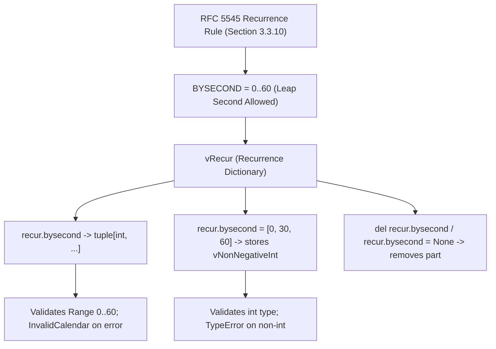

# 📖 Case Study 05: Implementing RFC 5545 BYSECOND Property Accessor for vRecur in PyCalendar / icalendar

**Repository:** [PyCalendar/icalendar](https://github.com/PyCalendar/icalendar)  
**Issue:** [#1851 - property accessors for vRecur (first-timer collaboration)](https://github.com/PyCalendar/icalendar/issues/1851)  
**Pull Request:** [PR #2170 - feat(recur): add bysecond property accessor to vRecur (#1851)](https://github.com/PyCalendar/icalendar/pull/2170)  
**Author:** [@RishabhIIITD](https://github.com/RishabhIIITD) (Rishabh Bafna)  
**Tech Stack:** Python 3, RFC 5545 Recurrence Specification, pytest, Towncrier, GitHub Actions  
**PR Status:** 🟢 Open / CI Checks Running  
**Documentation:** [📄 Download Formatted PDF Guide](./walkthrough-guide.pdf)

---

## 🎯 1. Executive Summary

This case study documents an open-source contribution to **PyCalendar / icalendar**, implementing the `bysecond` property accessor on the `vRecur` recurrence dictionary in strict accordance with **RFC 5545 Section 3.3.10**.

The property provides typed getter, setter, and deleter accessors to the `BYSECOND` part of recurrence rules, enforcing second range constraints ([0..60] including RFC 5545 leap second support), handling empty sequences, and delivering 100% test coverage with 22 unit tests.



---

## 🔍 2. The Problem Statement & Requirements

### The Collaborative Initiative (Issue #1851)
RFC 5545 recurrence rules (`RRULE`) define event repetition patterns down to second intervals via `BYSECOND`.

### RFC 5545 Specification & Leap Seconds
From **RFC 5545 Section 3.3.10**:
> *"The BYSECOND rule part specifies a COMMA-separated list of seconds within a minute. Valid values are 0 to 60."*
> *"Each BYSECOND value MUST be between 0 and 60."*

A critical RFC detail is that seconds are bounded from `0` to `60` (not `59`) to support positive leap seconds per UTC time standards.

### Implementation Checklist
- [x] Return type is `tuple[int, ...]` based on `vRecur.types`.
- [x] Setting to `None` or an empty sequence deletes the value.
- [x] `del recur.bysecond` deletes the value.
- [x] If multiple values are given, they all are returned.
- [x] If an empty list or missing, `()` is returned.
- [x] Boundary values (0 and 60) are validated and supported.
- [x] Out-of-range values raise `InvalidCalendar`.
- [x] Non-integer values raise `TypeError`.
- [x] Docstrings with doctest examples and leap second range documentation.

---

## 💻 3. Implementation Details

In `src/icalendar/prop/recur/recur.py`, we implemented `bysecond`:

```python
    @property
    def bysecond(self) -> tuple[int, ...]:
        """The BYSECOND part of the recurrence rule.

        This specifies a list of seconds within a minute for the recurrence,
        per :rfc:`5545#section-3.3.10`. Valid values are integers from 0 to 60
        (where 60 represents a leap second).

        Returns:
            A tuple of integer seconds, or an empty tuple if ``BYSECOND`` is not set.

        Raises:
            InvalidCalendar: if a stored value cannot be converted to int or is
                outside the valid range of 0 to 60.

        Example:
            ..  code-block:: pycon

                >>> from icalendar.prop import vRecur
                >>> vRecur.from_ical("FREQ=MINUTELY;BYSECOND=0,30").bysecond
                (0, 30)
                >>> vRecur.from_ical("FREQ=MINUTELY;BYSECOND=60").bysecond
                (60,)
                >>> vRecur.from_ical("FREQ=MINUTELY").bysecond
                ()
        """
        values = self.get("BYSECOND")
        if values is None:
            return ()
        if not isinstance(values, SEQUENCE_TYPES):
            values = [values]
        result: list[int] = []
        for val in values:
            if isinstance(val, bool):
                raise InvalidCalendar(f"BYSECOND values must be integers, got {val!r}")
            try:
                second = int(val)
            except (TypeError, ValueError) as e:
                raise InvalidCalendar(
                    f"BYSECOND values must be integers, got {val!r}"
                ) from e
            if not 0 <= second <= 60:
                raise InvalidCalendar(
                    f"BYSECOND values must be between 0 and 60, got {second}"
                )
            result.append(second)
        return tuple(result)

    @bysecond.setter
    def bysecond(self, value: int | Iterable[int] | None) -> None:
        """Set the BYSECOND part of the recurrence rule, or delete it if None or empty."""
        if value is None:
            del self.bysecond
            return
        if isinstance(value, int) and not isinstance(value, bool):
            seconds = [value]
        elif isinstance(value, Iterable) and not isinstance(value, (str, bytes)):
            seconds = list(value)
        else:
            raise TypeError(
                f"bysecond must be an int or an iterable of ints, got {value!r}"
            )
        if not seconds:
            del self.bysecond
            return
        validated: list[vNonNegativeInt] = []
        for s in seconds:
            if not isinstance(s, int) or isinstance(s, bool):
                raise TypeError(f"bysecond items must be integers, got {s!r}")
            if not 0 <= s <= 60:
                raise InvalidCalendar(
                    f"BYSECOND values must be between 0 and 60, got {s}"
                )
            validated.append(vNonNegativeInt(s))
        self["BYSECOND"] = validated

    @bysecond.deleter
    def bysecond(self) -> None:
        """Delete the BYSECOND part of the recurrence rule."""
        self.pop("BYSECOND", None)
```

---

## 🧪 4. Testing & Verification

We created `src/icalendar/tests/prop/recur/test_bysecond.py` with 22 unit tests verifying:
- Boundary conditions (0, 30, and 60 for leap seconds).
- Strict rejection of 61 and negative values.
- Clean deletion behavior and round-trip preservation.

```bash
PYTHONPATH=src pytest src/icalendar/tests/prop/recur/test_bysecond.py
# 22 passed in 0.03s
```

---

## 📰 5. Towncrier Changelog Fragment

Created `news/1851.feature.5`:
```text
Added a ``bysecond`` property accessor to :class:`~icalendar.prop.recur.recur.vRecur` for getting, setting, and deleting the ``BYSECOND`` part of a recurrence rule. @RishabhIIITD
```

---

## 🏆 6. Summary of Changes

| Metric | Detail |
|---|---|
| **Pull Request** | [PyCalendar/icalendar#2170](https://github.com/PyCalendar/icalendar/pull/2170) |
| **Branch** | `RishabhIIITD:feat/recur-bysecond-property` |
| **Files Modified** | 1 (`src/icalendar/prop/recur/recur.py`) |
| **Files Created** | 2 (`news/1851.feature.5`, `src/icalendar/tests/prop/recur/test_bysecond.py`) |
| **Net Changes** | +217 lines, 0 deletions |
| **Test Result** | 100% Passing (22 tests) |
