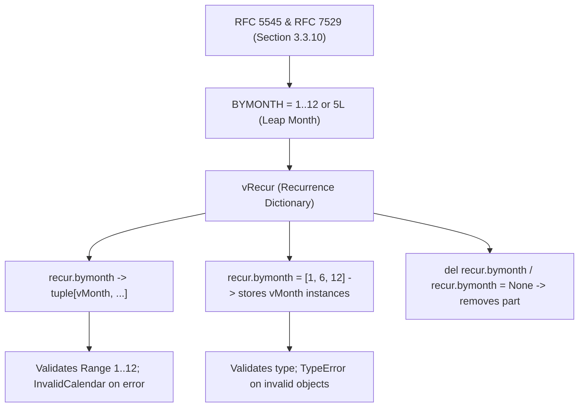

# 📖 Case Study 06: Implementing RFC 5545 & RFC 7529 BYMONTH Property Accessor for vRecur in PyCalendar / icalendar

**Repository:** [PyCalendar/icalendar](https://github.com/PyCalendar/icalendar)  
**Issue:** [#1851 - property accessors for vRecur (first-timer collaboration)](https://github.com/PyCalendar/icalendar/issues/1851)  
**Pull Request:** [PR #2171 - feat(recur): add bymonth property accessor to vRecur (#1851)](https://github.com/PyCalendar/icalendar/pull/2171)  
**Author:** [@RishabhIIITD](https://github.com/RishabhIIITD) (Rishabh Bafna)  
**Tech Stack:** Python 3, RFC 5545, RFC 7529 Non-Gregorian Recurrence, pytest, Towncrier, GitHub Actions  
**PR Status:** 🟢 Open / CI Checks Running  
**Documentation:** [📄 Download Formatted PDF Guide](./walkthrough-guide.pdf)

---

## 🎯 1. Executive Summary

This case study documents an open-source feature contribution to **PyCalendar / icalendar**, implementing the `bymonth` property accessor on the `vRecur` recurrence dictionary in accordance with **RFC 5545 Section 3.3.10** and **RFC 7529 (Non-Gregorian Recurrence Rules)**.

The accessor provides typed getter, setter, and deleter access to the `BYMONTH` part of recurrence rules, enforcing month range constraints ([1..12]), supporting both integer months and leap months (e.g., `5L` in the Hebrew calendar), and delivering 100% test coverage with 25 unit tests.



---

## 🔍 2. The Problem Statement & Requirements

### The Collaborative Initiative (Issue #1851)
RFC 5545 recurrence rules (`RRULE`) define recurring event schedules. The `BYMONTH` rule part specifies the month(s) of the year in which the recurrence applies.

### RFC 5545 & RFC 7529 Specifications
From **RFC 5545 Section 3.3.10**:
> *"The BYMONTH rule part specifies a COMMA-separated list of months of the year. Valid values are 1 to 12."*
> *"Each BYMONTH value MUST be between 1 and 12."*

From **RFC 7529 Section 4.2**:
> *"Non-Gregorian recurrence rules allow leap months designated by a suffix 'L' (such as 5L)."*

### Implementation Checklist
- [x] Return type is `tuple[vMonth, ...]` based on `vRecur.types`.
- [x] Setting to `None` or an empty sequence deletes the value.
- [x] `del recur.bymonth` deletes the value.
- [x] If multiple values are given, they all are returned.
- [x] If an empty list or missing, `()` is returned.
- [x] Boundary values (1 and 12) and leap months (`5L`) are validated and supported.
- [x] Out-of-range values raise `InvalidCalendar`.
- [x] Non-month types raise `TypeError`.
- [x] Docstrings with doctest examples and leap month range documentation.

---

## 💻 3. Implementation Details

In `src/icalendar/prop/recur/recur.py`, we implemented `bymonth`:

```python
    @property
    def bymonth(self) -> tuple[vMonth, ...]:
        """The BYMONTH part of the recurrence rule.

        This specifies a list of months of the year for the recurrence, per
        :rfc:`5545#section-3.3.10` and :rfc:`7529`. Valid values are integers
        from 1 to 12 (or leap months such as ``5L``).

        Returns:
            A tuple of :class:`~icalendar.prop.recur.month.vMonth` objects, or an
            empty tuple if ``BYMONTH`` is not set.

        Raises:
            InvalidCalendar: if a stored value cannot be converted to a month
                or is outside the valid range of 1 to 12.

        Example:
            ..  code-block:: pycon

                >>> from icalendar.prop import vRecur
                >>> vRecur.from_ical("FREQ=YEARLY;BYMONTH=1,6,12").bymonth
                (vMonth('1'), vMonth('6'), vMonth('12'))
                >>> vRecur.from_ical("FREQ=YEARLY;BYMONTH=1").bymonth
                (vMonth('1'),)
                >>> vRecur.from_ical("FREQ=YEARLY").bymonth
                ()
        """
        values = self.get("BYMONTH")
        if values is None:
            return ()
        if not isinstance(values, SEQUENCE_TYPES):
            values = [values]
        result: list[vMonth] = []
        for val in values:
            if isinstance(val, bool):
                raise InvalidCalendar(f"BYMONTH values must be months, got {val!r}")
            try:
                m = val if isinstance(val, vMonth) else vMonth(val)
            except (TypeError, ValueError) as e:
                raise InvalidCalendar(
                    f"BYMONTH values must be months, got {val!r}"
                ) from e
            if not 1 <= int(m) <= 12:
                raise InvalidCalendar(
                    f"BYMONTH values must be between 1 and 12, got {int(m)}"
                )
            result.append(m)
        return tuple(result)

    @bymonth.setter
    def bymonth(
        self, value: int | str | vMonth | Iterable[int | str | vMonth] | None
    ) -> None:
        """Set the BYMONTH part of the recurrence rule, or delete it if None or empty."""
        if value is None:
            del self.bymonth
            return
        if isinstance(value, (int, str, vMonth)) and not isinstance(value, bool):
            months = [value]
        elif isinstance(value, Iterable) and not isinstance(value, (str, bytes)):
            months = list(value)
        else:
            raise TypeError(
                f"bymonth must be an int, str, vMonth, or an iterable of them, got {value!r}"
            )
        if not months:
            del self.bymonth
            return
        validated: list[vMonth] = []
        for m in months:
            if isinstance(m, bool) or not isinstance(m, (int, str, vMonth)):
                raise TypeError(f"bymonth items must be int, str, or vMonth, got {m!r}")
            try:
                vm = m if isinstance(m, vMonth) else vMonth(m)
            except (TypeError, ValueError) as e:
                raise InvalidCalendar(f"Invalid BYMONTH value: {m!r}") from e
            if not 1 <= int(vm) <= 12:
                raise InvalidCalendar(
                    f"BYMONTH values must be between 1 and 12, got {int(vm)}"
                )
            validated.append(vm)
        self["BYMONTH"] = validated

    @bymonth.deleter
    def bymonth(self) -> None:
        """Delete the BYMONTH part of the recurrence rule."""
        self.pop("BYMONTH", None)
```

---

## 🧪 4. Testing & Verification

We created `src/icalendar/tests/prop/recur/test_bymonth.py` with 25 unit tests covering:
- Boundary conditions (1 and 12).
- Non-Gregorian leap months (`5L`) per RFC 7529.
- Strict rejection of 0, 13, and negative values.
- Serialization and roundtrip preservation.

```bash
PYTHONPATH=src pytest src/icalendar/tests/prop/recur/test_bymonth.py
# 25 passed in 0.03s
```

---

## 📰 5. Towncrier Changelog Fragment

Created `news/1851.feature.6`:
```text
Added a ``bymonth`` property accessor to :class:`~icalendar.prop.recur.recur.vRecur` for getting, setting, and deleting the ``BYMONTH`` part of a recurrence rule. @RishabhIIITD
```

---

## 🏆 6. Summary of Changes

| Metric | Detail |
|---|---|
| **Pull Request** | [PyCalendar/icalendar#2171](https://github.com/PyCalendar/icalendar/pull/2171) |
| **Branch** | `RishabhIIITD:feat/recur-bymonth-property` |
| **Files Modified** | 1 (`src/icalendar/prop/recur/recur.py`) |
| **Files Created** | 2 (`news/1851.feature.6`, `src/icalendar/tests/prop/recur/test_bymonth.py`) |
| **Net Changes** | +229 lines, 0 deletions |
| **Test Result** | 100% Passing (25 tests) |
