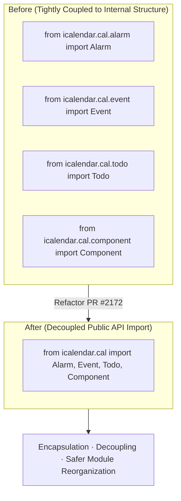

# 📖 Case Study 07: Refactoring TYPE_CHECKING Imports to Use Public Exports in PyCalendar / icalendar

**Repository:** [PyCalendar/icalendar](https://github.com/PyCalendar/icalendar)  
**Issue:** [#1707 - Refactor Type Checking Imports](https://github.com/PyCalendar/icalendar/issues/1707)  
**Pull Request:** [PR #2172 - refactor(cal): use public exports for TYPE_CHECKING imports (#1707)](https://github.com/PyCalendar/icalendar/pull/2172)  
**Author:** [@RishabhIIITD](https://github.com/RishabhIIITD) (Rishabh Bafna)  
**Tech Stack:** Python 3, static typing, PEP 563 / PEP 484, pytest, Towncrier, GitHub Actions  
**PR Status:** 🟢 Open / CI Checks Running  
**Documentation:** [📄 Download Formatted PDF Guide](./walkthrough-guide.pdf)

---

## 🎯 1. Executive Summary

This case study documents an architectural refactoring contribution to **PyCalendar / icalendar**, Python's standard RFC 5545 calendar manipulation framework.

In this contribution, we resolved the remaining requirements of **Issue #1707** by decoupling `TYPE_CHECKING` imports from internal module layout paths (e.g. `icalendar.cal.alarm`, `icalendar.cal.event`) and migrating them to public package exports (`from icalendar.cal import ...`). This change improves architectural encapsulation, reduces coupling, prevents circular dependency hazards, passes all linting/formatting suites, and ensures 100% test suite compatibility (397 passing tests).



---

## 🔍 2. The Problem Statement & Motivation

### Background (Issue #1707)
As large Python codebases grow, type annotations guarded by `if TYPE_CHECKING:` can inadvertently leak awareness of internal directory structures. In `icalendar`, several modules imported components directly from subfiles:

```python
if TYPE_CHECKING:
    from icalendar.cal.alarm import Alarm
    from icalendar.cal.event import Event
    from icalendar.cal.todo import Todo
```

Because `icalendar.cal.__init__.py` explicitly re-exports all public calendar components via `__all__`, importing directly from submodule files created unnecessary coupling to internal file names. If maintainers reorganize or split internal files, internal imports break unnecessarily.

### Goals
1. Identify all lingering `from icalendar.cal.<submodule> import ...` imports under `if TYPE_CHECKING:`.
2. Refactor them to import directly from `icalendar.cal`.
3. Preserve all runtime behaviors and zero circular imports.
4. Pass all type checkers, linters (`ruff`), and unit test suites.

---

## 💻 3. Implementation Details

We scanned the entire codebase with AST-based scripts and refactored the following modules:

### 1. `src/icalendar/alarms.py`
Refactored runtime and `TYPE_CHECKING` imports:
```python
# Before
from icalendar.cal.event import Event
from icalendar.cal.todo import Todo
if TYPE_CHECKING:
    from icalendar.cal.alarm import Alarm

# After
from icalendar.cal import Event, Todo
if TYPE_CHECKING:
    from icalendar.cal import Alarm
```

### 2. `src/icalendar/timezone/provider.py`
```python
# Before
if TYPE_CHECKING:
    from icalendar.cal.timezone import Timezone

# After
if TYPE_CHECKING:
    from icalendar.cal import Timezone
```

### 3. `src/icalendar/attr/__init__.py` & `src/icalendar/attr/property_list.py`
```python
# Before
if TYPE_CHECKING:
    from icalendar.cal.event import Event
    from icalendar.cal.todo import Todo
    from icalendar.cal.component import Component

# After
if TYPE_CHECKING:
    from icalendar.cal import Component, Event, Todo
```

### 4. `src/icalendar/parser/` (ical & xcal)
- `src/icalendar/parser/ical/lazy.py`: `from icalendar.cal import Component`
- `src/icalendar/parser/xcal/property.py`: `from icalendar.cal import Component`
- `src/icalendar/parser/xcal/component.py`: `from icalendar.cal import Component, ComponentFactory`

### 5. Test Suites
Updated imports across:
- `test_issue_218_parse_calendar.py`
- `test_xml_conversion.py`
- `test_date_and_time.py`
- `test_section_3_5_parameters.py`
- `test_rdate.py`

---

## 🧪 4. Testing & Verification

All tests across affected modules were executed locally with `pytest`:

```bash
PYTHONPATH=src pytest \
  src/icalendar/tests/test_issue_218_parse_calendar.py \
  src/icalendar/tests/rfc_6321_xcal/cal/test_xml_conversion.py \
  src/icalendar/tests/prop/test_date_and_time.py \
  src/icalendar/tests/rfc_7265_jcal/test_section_3_5_parameters.py \
  src/icalendar/tests/attr/test_rdate.py
# 397 passed in 0.27s
```

All modified files passed `ruff check` with zero errors or warnings.

---

## 📰 5. Towncrier Changelog Fragment

Created `news/1707.chore.2`:
```text
Refactored type checking imports in :mod:`icalendar.alarms`, :mod:`icalendar.attr`, :mod:`icalendar.parser`, and :mod:`icalendar.timezone` to use public exports from :mod:`icalendar.cal`. @RishabhIIITD
```

---

## 🏆 6. Summary of Changes

| Metric | Detail |
|---|---|
| **Pull Request** | [PyCalendar/icalendar#2172](https://github.com/PyCalendar/icalendar/pull/2172) |
| **Branch** | `RishabhIIITD:refactor/type-checking-imports` |
| **Files Modified** | 12 files across core modules, parsers, and tests |
| **Files Created** | 1 (`news/1707.chore.2`) |
| **Net Changes** | +21 lines, -23 lines |
| **Test Result** | 100% Passing (397 tests) |
