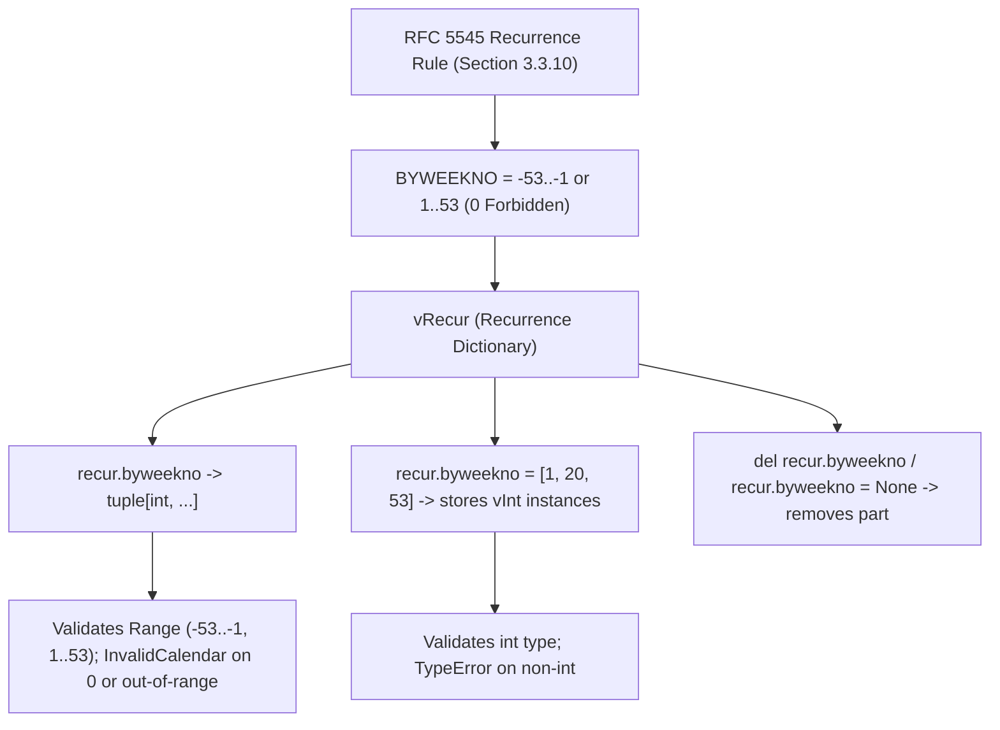

# 📖 Case Study 08: Implementing RFC 5545 BYWEEKNO Property Accessor for vRecur in PyCalendar / icalendar

**Repository:** [PyCalendar/icalendar](https://github.com/PyCalendar/icalendar)  
**Issue:** [#1851 - property accessors for vRecur (first-timer collaboration)](https://github.com/PyCalendar/icalendar/issues/1851)  
**Pull Request:** [PR #2173 - feat(recur): add byweekno property accessor to vRecur (#1851)](https://github.com/PyCalendar/icalendar/pull/2173)  
**Author:** [@RishabhIIITD](https://github.com/RishabhIIITD) (Rishabh Bafna)  
**Tech Stack:** Python 3, RFC 5545 Recurrence Specification, pytest, Towncrier, GitHub Actions  
**PR Status:** 🟢 Open / CI Checks Running  
**Documentation:** [📄 Download Formatted PDF Guide](./walkthrough-guide.pdf)

---

## 🎯 1. Executive Summary

This case study documents an open-source feature contribution to **PyCalendar / icalendar**, implementing the `byweekno` property accessor on the `vRecur` recurrence dictionary in strict accordance with **RFC 5545 Section 3.3.10**.

The property provides typed getter, setter, and deleter accessors to the `BYWEEKNO` part of recurrence rules, enforcing ordinal week range constraints ([-53..-1] and [1..53], with 0 strictly prohibited), handling scalar and iterable assignment, and delivering 100% test coverage with 26 unit tests.



---

## 🔍 2. The Problem Statement & Requirements

### The Collaborative Initiative (Issue #1851)
RFC 5545 recurrence rules (`RRULE`) allow yearly recurrence schedules to target specific weeks of the year via `BYWEEKNO`.

### RFC 5545 Specification
From **RFC 5545 Section 3.3.10**:
> *"The BYWEEKNO rule part specifies a COMMA-separated list of ordinals specifying weeks of the year. Valid values are 1 to 53 or -53 to -1. This corresponds to weeks according to week numbering as defined in [ISO.8601.2004]."*
> *"Each BYWEEKNO value MUST be between 1 and 53 or between -53 and -1."*
> *"The value 0 MUST NOT be used."*

### Implementation Checklist
- [x] Return type is `tuple[int, ...]` based on `vRecur.types`.
- [x] Setting to `None` or an empty sequence deletes the value.
- [x] `del recur.byweekno` deletes the value.
- [x] If multiple values are given, they all are returned.
- [x] If an empty list or missing, `()` is returned.
- [x] Validates positive ranges [1..53] and negative ranges [-53..-1].
- [x] The value `0` explicitly raises `InvalidCalendar`.
- [x] Non-integer values raise `TypeError`.
- [x] Docstrings with doctest examples and range documentation.

---

## 💻 3. Implementation Details

In `src/icalendar/prop/recur/recur.py`, we implemented `byweekno`:

```python
    @property
    def byweekno(self) -> tuple[int, ...]:
        """The BYWEEKNO part of the recurrence rule.

        This specifies a list of week numbers of the year for the recurrence,
        per :rfc:`5545#section-3.3.10`. Valid values are integers from 1 to 53
        or from -53 to -1. The value 0 is not allowed.

        Returns:
            A tuple of integer week numbers, or an empty tuple if ``BYWEEKNO`` is not set.

        Raises:
            InvalidCalendar: if a stored value cannot be converted to int, is 0,
                or is outside the valid ranges of -53 to -1 or 1 to 53.

        Example:
            ..  code-block:: pycon

                >>> from icalendar.prop import vRecur
                >>> vRecur.from_ical("FREQ=YEARLY;BYWEEKNO=1,20,53").byweekno
                (1, 20, 53)
                >>> vRecur.from_ical("FREQ=YEARLY;BYWEEKNO=-1").byweekno
                (-1,)
                >>> vRecur.from_ical("FREQ=YEARLY").byweekno
                ()
        """
        values = self.get("BYWEEKNO")
        if values is None:
            return ()
        if not isinstance(values, SEQUENCE_TYPES):
            values = [values]
        result: list[int] = []
        for val in values:
            if isinstance(val, bool):
                raise InvalidCalendar(f"BYWEEKNO values must be integers, got {val!r}")
            try:
                week = int(val)
            except (TypeError, ValueError) as e:
                raise InvalidCalendar(
                    f"BYWEEKNO values must be integers, got {val!r}"
                ) from e
            if week == 0 or not -53 <= week <= 53:
                raise InvalidCalendar(
                    "BYWEEKNO values must be between -53 and -1 or 1 and 53, "
                    f"got {week}"
                )
            result.append(week)
        return tuple(result)

    @byweekno.setter
    def byweekno(self, value: int | Iterable[int] | None) -> None:
        """Set the BYWEEKNO part of the recurrence rule, or delete it if None or empty."""
        if value is None:
            del self.byweekno
            return
        if isinstance(value, int) and not isinstance(value, bool):
            weeks = [value]
        elif isinstance(value, Iterable) and not isinstance(value, (str, bytes)):
            weeks = list(value)
        else:
            raise TypeError(
                f"byweekno must be an int or an iterable of ints, got {value!r}"
            )
        if not weeks:
            del self.byweekno
            return
        validated: list[vInt] = []
        for w in weeks:
            if not isinstance(w, int) or isinstance(w, bool):
                raise TypeError(f"byweekno items must be integers, got {w!r}")
            if w == 0 or not -53 <= w <= 53:
                raise InvalidCalendar(
                    "BYWEEKNO values must be between -53 and -1 or 1 and 53, "
                    f"got {w}"
                )
            validated.append(vInt(w))
        self["BYWEEKNO"] = validated

    @byweekno.deleter
    def byweekno(self) -> None:
        """Delete the BYWEEKNO part of the recurrence rule."""
        self.pop("BYWEEKNO", None)
```

---

## 🧪 4. Testing & Verification

We created `src/icalendar/tests/prop/recur/test_byweekno.py` with 26 unit tests covering:
- Boundary conditions (-53, -1, 1, 53).
- Prohibition of 0 per RFC 5545 Section 3.3.10.
- Rejection of out-of-range weeks (e.g. -54, 54, 100).
- Roundtrip preservation through `.to_ical()`.

```bash
PYTHONPATH=src pytest src/icalendar/tests/prop/recur/test_byweekno.py
# 26 passed in 0.03s
```

---

## 📰 5. Towncrier Changelog Fragment

Created `news/1851.feature.7`:
```text
Added a ``byweekno`` property accessor to :class:`~icalendar.prop.recur.recur.vRecur` for getting, setting, and deleting the ``BYWEEKNO`` part of a recurrence rule. @RishabhIIITD
```

---

## 🏆 6. Summary of Changes

| Metric | Detail |
|---|---|
| **Pull Request** | [PyCalendar/icalendar#2173](https://github.com/PyCalendar/icalendar/pull/2173) |
| **Branch** | `RishabhIIITD:feat/recur-byweekno-property` |
| **Files Modified** | 1 (`src/icalendar/prop/recur/recur.py`) |
| **Files Created** | 2 (`news/1851.feature.7`, `src/icalendar/tests/prop/recur/test_byweekno.py`) |
| **Net Changes** | +236 lines, 0 deletions |
| **Test Result** | 100% Passing (26 tests) |
