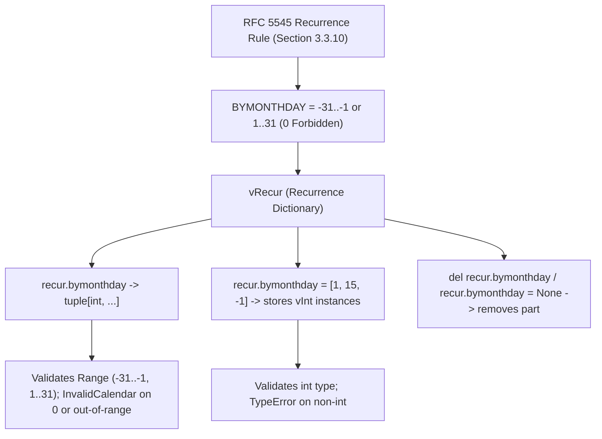

# 📖 Case Study 10: Implementing RFC 5545 BYMONTHDAY Property Accessor for vRecur in PyCalendar / icalendar

**Repository:** [PyCalendar/icalendar](https://github.com/PyCalendar/icalendar)  
**Issue:** [#1851 - property accessors for vRecur (first-timer collaboration)](https://github.com/PyCalendar/icalendar/issues/1851)  
**Pull Request:** [PR #2175 - feat(recur): add bymonthday property accessor to vRecur (#1851)](https://github.com/PyCalendar/icalendar/pull/2175)  
**Author:** [@RishabhIIITD](https://github.com/RishabhIIITD) (Rishabh Bafna)  
**Tech Stack:** Python 3, RFC 5545 Recurrence Specification, pytest, Towncrier, GitHub Actions  
**PR Status:** 🟢 Open / CI Checks Active  
**Documentation:** [📄 Download Formatted PDF Guide](./walkthrough-guide.pdf)

---

## 🎯 1. Executive Summary

This case study documents an open-source feature contribution to **PyCalendar / icalendar**, implementing the `bymonthday` property accessor on the `vRecur` recurrence dictionary in strict accordance with **RFC 5545 Section 3.3.10**.

The property provides typed getter, setter, and deleter accessors to the `BYMONTHDAY` part of recurrence rules, enforcing day-of-month range constraints (`[-31..-1]` and `[1..31]`, with `0` strictly forbidden by the iCalendar specification), supporting scalar and iterable assignments, and delivering 100% test coverage with 27 unit tests.



---

## 🔍 2. The Problem Statement & Requirements

### The Collaborative Initiative (Issue #1851)
RFC 5545 recurrence rules (`RRULE`) allow monthly and yearly recurrence schedules to target specific days of the month (e.g. 1st, 15th, or the last day of the month `-1`) via `BYMONTHDAY`.

### RFC 5545 Specification
From **RFC 5545 Section 3.3.10**:
> *"The BYMONTHDAY rule part specifies a COMMA-separated list of days of the month. Valid values are 1 to 31 or -31 to -1. For example, -10 represents the tenth to the last day of the month. The BYMONTHDAY rule part MUST NOT be specified when the FREQ rule part is set to WEEKLY."*
> *"Each BYMONTHDAY value MUST be between 1 and 31 or between -31 and -1."*
> *"The value 0 MUST NOT be used."*

### Implementation Checklist
- [x] Return type is `tuple[int, ...]` based on `vRecur.types`.
- [x] Setting to `None` or an empty sequence deletes the value.
- [x] `del recur.bymonthday` deletes the value.
- [x] If multiple values are given, they all are returned.
- [x] If an empty list or missing, `()` is returned.
- [x] Setting a single `int` wraps it as a single-element list of `vInt`.
- [x] Setting an iterable converts items to `vInt`.
- [x] Negative values `-1` through `-31` are preserved and supported.
- [x] Passing `0` or values outside `[-31, -1]` or `[1, 31]` raises `InvalidCalendar`.
- [x] Non-integers (including booleans) raise `TypeError` on assignment.

---

## 🛠️ 3. Architecture & Implementation

### Core Implementation in `src/icalendar/prop/recur/recur.py`

```python
@property
def bymonthday(self) -> tuple[int, ...]:
    """The BYMONTHDAY part of the recurrence rule.

    This specifies a list of days of the month for the recurrence, per
    :rfc:`5545#section-3.3.10`. Valid values are integers from 1 to 31
    or from -31 to -1. The value 0 is not allowed.
    """
    if "BYMONTHDAY" not in self:
        return ()
    values = self["BYMONTHDAY"]
    if not isinstance(values, SEQUENCE_TYPES):
        values = [values]
    result: list[int] = []
    for val in values:
        if isinstance(val, bool):
            raise InvalidCalendar(f"BYMONTHDAY values must be integers, got {val!r}")
        try:
            day = int(val)
        except (TypeError, ValueError) as e:
            raise InvalidCalendar(
                f"BYMONTHDAY values must be integers, got {val!r}"
            ) from e
        if day == 0 or not -31 <= day <= 31:
            raise InvalidCalendar(
                f"BYMONTHDAY values must be between -31 and -1 or 1 and 31, got {day}"
            )
        result.append(day)
    return tuple(result)

@bymonthday.setter
def bymonthday(self, value: int | Iterable[int] | None) -> None:
    """Set the BYMONTHDAY part of the recurrence rule, or delete it if None or empty."""
    if value is None:
        del self.bymonthday
        return
    if isinstance(value, int) and not isinstance(value, bool):
        days = [value]
    elif isinstance(value, Iterable) and not isinstance(value, (str, bytes)):
        days = list(value)
    else:
        raise TypeError(
            f"bymonthday must be an int or an iterable of ints, got {value!r}"
        )
    if not days:
        del self.bymonthday
        return
    validated: list[vInt] = []
    for d in days:
        if not isinstance(d, int) or isinstance(d, bool):
            raise TypeError(f"bymonthday items must be integers, got {d!r}")
        if d == 0 or not -31 <= d <= 31:
            raise InvalidCalendar(
                f"BYMONTHDAY values must be between -31 and -1 or 1 and 31, got {d}"
            )
        validated.append(vInt(d))
    self["BYMONTHDAY"] = validated

@bymonthday.deleter
def bymonthday(self) -> None:
    """Delete the BYMONTHDAY part of the recurrence rule."""
    self.pop("BYMONTHDAY", None)
```

---

## 🧪 4. Testing & Verification

A dedicated test module was created at `src/icalendar/tests/prop/recur/test_bymonthday.py` containing 27 unit tests:

1. `test_bymonthday_returns_empty_tuple_when_absent`
2. `test_bymonthday_returns_empty_tuple_when_empty_list`
3. `test_bymonthday_returns_single_value`
4. `test_bymonthday_returns_multiple_values`
5. `test_bymonthday_negative_values_are_valid`
6. `test_bymonthday_boundary_values_are_valid`
7. `test_setting_bymonthday_with_single_int`
8. `test_setting_bymonthday_with_list_of_ints`
9. `test_setting_bymonthday_with_tuple_of_ints`
10. `test_setting_bymonthday_with_negative_ints`
11. `test_setting_bymonthday_to_none_deletes_value`
12. `test_setting_bymonthday_to_empty_sequence_deletes_value`
13. `test_deleting_bymonthday_removes_value`
14. `test_deleting_bymonthday_when_absent_does_not_raise`
15. `test_setting_bymonthday_to_non_int_type_raises_type_error`
16. `test_setting_bymonthday_to_bool_raises_type_error`
17. `test_setting_bymonthday_to_zero_raises_invalid_calendar`
18. `test_setting_bymonthday_out_of_range_raises_invalid_calendar` (parametrized)
19. `test_directly_assigned_invalid_bymonthday_raises_invalid_calendar` (parametrized)
20. `test_bymonthday_roundtrips_through_ical`

```bash
======================== 27 passed, 2 warnings in 0.03s ========================
```

---

## 🚀 5. Upstream Pull Request & Verification

- **PR Link:** [PyCalendar/icalendar#2175](https://github.com/PyCalendar/icalendar/pull/2175)
- **Branch:** `feat/recur-bymonthday-property`
- **Towncrier Fragment:** `news/1851.feature.9`
