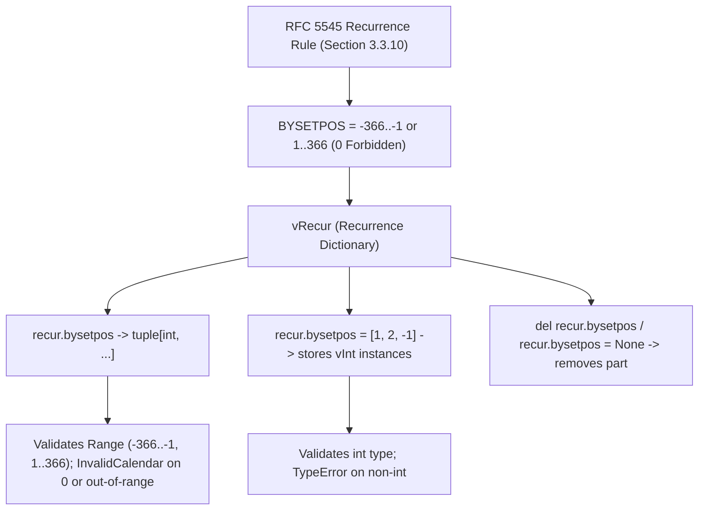

# 📖 Case Study 11: Implementing RFC 5545 BYSETPOS Property Accessor for vRecur in PyCalendar / icalendar

**Repository:** [PyCalendar/icalendar](https://github.com/PyCalendar/icalendar)  
**Issue:** [#1851 - property accessors for vRecur (first-timer collaboration)](https://github.com/PyCalendar/icalendar/issues/1851)  
**Pull Request:** [PR #2176 - feat(recur): add bysetpos property accessor to vRecur (#1851)](https://github.com/PyCalendar/icalendar/pull/2176)  
**Author:** [@RishabhIIITD](https://github.com/RishabhIIITD) (Rishabh Bafna)  
**Tech Stack:** Python 3, RFC 5545 Recurrence Specification, pytest, Towncrier, GitHub Actions  
**PR Status:** 🟢 Open / CI Checks Active  
**Documentation:** [📄 Download Formatted PDF Guide](./walkthrough-guide.pdf)

---

## 🎯 1. Executive Summary

This case study documents an open-source feature contribution to **PyCalendar / icalendar**, implementing the `bysetpos` property accessor on the `vRecur` recurrence dictionary in strict accordance with **RFC 5545 Section 3.3.10**.

The property provides typed getter, setter, and deleter accessors to the `BYSETPOS` part of recurrence rules, enforcing set-position range constraints (`[-366..-1]` and `[1..366]`, with `0` strictly forbidden by the iCalendar specification), supporting scalar and iterable assignments, and delivering 100% test coverage with 25 unit tests.



---

## 🔍 2. The Problem Statement & Requirements

### The Collaborative Initiative (Issue #1851)
RFC 5545 recurrence rules (`RRULE`) allow recurrence schedules to pinpoint specific occurrences within an interval (such as the last workday of the month `BYDAY=MO,TU,WE,TH,FR;BYSETPOS=-1`) via `BYSETPOS`.

### RFC 5545 Specification
From **RFC 5545 Section 3.3.10**:
> *"The BYSETPOS rule part specifies a COMMA-separated list of values that corresponds to the nth occurrence within the set of recurrence instances in an interval. Valid values are 1 to 366 or -366 to -1. It MUST only be used in conjunction with another BYxxx rule part."*
> *"Each BYSETPOS value MUST be between 1 and 366 or between -366 and -1."*
> *"The value 0 MUST NOT be used."*

### Implementation Checklist
- [x] Return type is `tuple[int, ...]` based on `vRecur.types`.
- [x] Setting to `None` or an empty sequence deletes the value.
- [x] `del recur.bysetpos` deletes the value.
- [x] If multiple values are given, they all are returned.
- [x] If an empty list or missing, `()` is returned.
- [x] Setting a single `int` wraps it as a single-element list of `vInt`.
- [x] Setting an iterable converts items to `vInt`.
- [x] Negative values `-1` through `-366` are preserved and supported.
- [x] Passing `0` or values outside `[-366, -1]` or `[1, 366]` raises `InvalidCalendar`.
- [x] Non-integers (including booleans) raise `TypeError` on assignment.

---

## 🛠️ 3. Architecture & Implementation

### Core Implementation in `src/icalendar/prop/recur/recur.py`

```python
@property
def bysetpos(self) -> tuple[int, ...]:
    """The BYSETPOS part of the recurrence rule.

    This specifies a list of positions within the recurrence instances, per
    :rfc:`5545#section-3.3.10`. Valid values are integers from 1 to 366
    or from -366 to -1. The value 0 is not allowed.
    """
    if "BYSETPOS" not in self:
        return ()
    values = self["BYSETPOS"]
    if not isinstance(values, SEQUENCE_TYPES):
        values = [values]
    result: list[int] = []
    for val in values:
        if isinstance(val, bool):
            raise InvalidCalendar(f"BYSETPOS values must be integers, got {val!r}")
        try:
            pos = int(val)
        except (TypeError, ValueError) as e:
            raise InvalidCalendar(
                f"BYSETPOS values must be integers, got {val!r}"
            ) from e
        if pos == 0 or not -366 <= pos <= 366:
            raise InvalidCalendar(
                f"BYSETPOS values must be between -366 and -1 or 1 and 366, got {pos}"
            )
        result.append(pos)
    return tuple(result)

@bysetpos.setter
def bysetpos(self, value: int | Iterable[int] | None) -> None:
    """Set the BYSETPOS part of the recurrence rule, or delete it if None or empty."""
    if value is None:
        del self.bysetpos
        return
    if isinstance(value, int) and not isinstance(value, bool):
        positions = [value]
    elif isinstance(value, Iterable) and not isinstance(value, (str, bytes)):
        positions = list(value)
    else:
        raise TypeError(
            f"bysetpos must be an int or an iterable of ints, got {value!r}"
        )
    if not positions:
        del self.bysetpos
        return
    validated: list[vInt] = []
    for p in positions:
        if not isinstance(p, int) or isinstance(p, bool):
            raise TypeError(f"bysetpos items must be integers, got {p!r}")
        if p == 0 or not -366 <= p <= 366:
            raise InvalidCalendar(
                f"BYSETPOS values must be between -366 and -1 or 1 and 366, got {p}"
            )
        validated.append(vInt(p))
    self["BYSETPOS"] = validated

@bysetpos.deleter
def bysetpos(self) -> None:
    """Delete the BYSETPOS part of the recurrence rule."""
    self.pop("BYSETPOS", None)
```

---

## 🧪 4. Testing & Verification

A dedicated test module was created at `src/icalendar/tests/prop/recur/test_bysetpos.py` containing 25 unit tests:

1. `test_bysetpos_returns_empty_tuple_when_absent`
2. `test_bysetpos_returns_empty_tuple_when_empty_list`
3. `test_bysetpos_returns_single_value`
4. `test_bysetpos_returns_multiple_values`
5. `test_bysetpos_boundary_values_are_valid`
6. `test_setting_bysetpos_with_single_int`
7. `test_setting_bysetpos_with_list_of_ints`
8. `test_setting_bysetpos_with_tuple_of_ints`
9. `test_setting_bysetpos_to_none_deletes_value`
10. `test_setting_bysetpos_to_empty_sequence_deletes_value`
11. `test_deleting_bysetpos_removes_value`
12. `test_deleting_bysetpos_when_absent_does_not_raise`
13. `test_setting_bysetpos_to_non_int_type_raises_type_error`
14. `test_setting_bysetpos_to_bool_raises_type_error`
15. `test_setting_bysetpos_to_zero_raises_invalid_calendar`
16. `test_setting_bysetpos_out_of_range_raises_invalid_calendar` (parametrized)
17. `test_directly_assigned_invalid_bysetpos_raises_invalid_calendar` (parametrized)
18. `test_bysetpos_roundtrips_through_ical`

```bash
======================== 25 passed, 2 warnings in 0.03s ========================
```

---

## 🚀 5. Upstream Pull Request & Verification

- **PR Link:** [PyCalendar/icalendar#2176](https://github.com/PyCalendar/icalendar/pull/2176)
- **Branch:** `feat/recur-bysetpos-property`
- **Towncrier Fragment:** `news/1851.feature.10`
