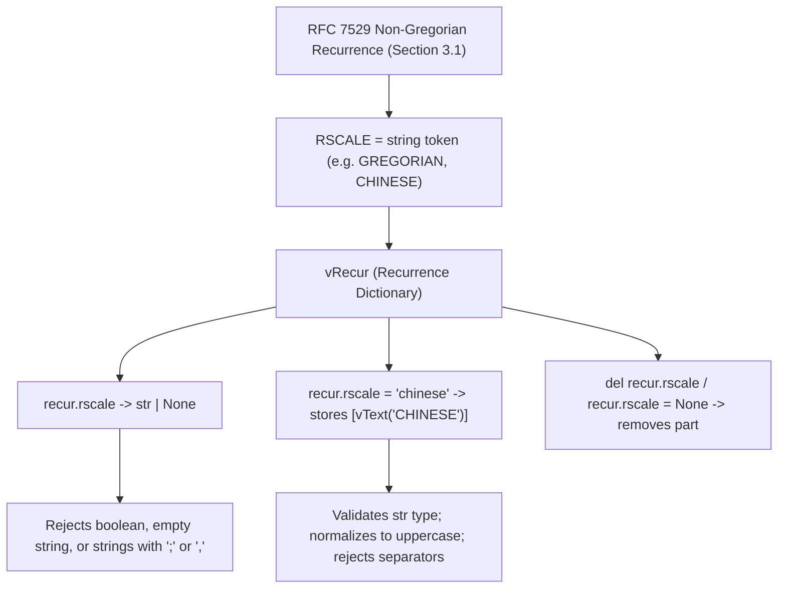

# 📖 Case Study 12: Implementing RFC 7529 RSCALE Property Accessor for vRecur in PyCalendar / icalendar

**Repository:** [PyCalendar/icalendar](https://github.com/PyCalendar/icalendar)  
**Issue:** [#1851 - property accessors for vRecur (first-timer collaboration)](https://github.com/PyCalendar/icalendar/issues/1851)  
**Pull Request:** [PR #2177 - feat(recur): add rscale property accessor to vRecur (#1851, RFC 7529)](https://github.com/PyCalendar/icalendar/pull/2177)  
**Author:** [@RishabhIIITD](https://github.com/RishabhIIITD) (Rishabh Bafna)  
**Tech Stack:** Python 3, RFC 7529 Non-Gregorian Recurrence Specification, pytest, Towncrier, GitHub Actions  
**PR Status:** 🟢 Open / CI Checks Active  
**Documentation:** [📄 Download Formatted PDF Guide](./walkthrough-guide.pdf)

---

## 🎯 1. Executive Summary

This case study documents an open-source feature contribution to **PyCalendar / icalendar**, implementing the `rscale` property accessor on the `vRecur` recurrence dictionary in strict accordance with **RFC 7529 Section 3.1** (*Non-Gregorian Recurrence Rules in iCalendar*).

The property provides typed getter, setter, and deleter accessors to the `RSCALE` calendar scale parameter (e.g., `GREGORIAN`, `CHINESE`, `ETHIOPIC`, `HEBREW`, `ISLAMIC`), enforcing string validations, automatic uppercase normalization, recurrence part separator rejection (`;` and `,`), and delivering 100% test coverage with 21 unit tests.



---

## 🔍 2. The Problem Statement & Requirements

### The Collaborative Initiative (Issue #1851)
RFC 7529 defines an extension to the iCalendar recurrence grammar to support non-Gregorian calendar systems (such as Hebrew, Islamic, Ethiopic, and Chinese calendars) using the `RSCALE` rule part.

### RFC 7529 Specification
From **RFC 7529 Section 3.1**:
> *"The RSCALE rule part specifies the calendar scale used for the recurrence rule. If present, it MUST appear only once in an RRULE."*
> *"Calendar scale names are case-insensitive... conventionally written in uppercase."*
> *"RECUR has no escaping, so a text value cannot contain the part separator ';' or the list separator ','."*

### Implementation Checklist
- [x] Return type is `str | None` based on `vRecur.types`.
- [x] Setting to `None` deletes the value.
- [x] `del recur.rscale` deletes the value.
- [x] If present, the value is normalized to uppercase.
- [x] If missing or empty list, `None` is returned.
- [x] Setting string strips whitespace and normalizes to uppercase.
- [x] Passing non-string types (including `bool`) raises `TypeError`.
- [x] Passing empty string or strings containing `;` or `,` raises `InvalidCalendar`.
- [x] Roundtrips cleanly through `.to_ical()` and `.from_ical()`.

---

## 🛠️ 3. Architecture & Implementation

### Core Implementation in `src/icalendar/prop/recur/recur.py`

```python
@property
def rscale(self) -> str | None:
    """The RSCALE part of the recurrence rule.

    This specifies the calendar scale used for the recurrence rule, per
    :rfc:`7529#section-3.1`. Common values include ``GREGORIAN``,
    ``CHINESE``, ``ETHIOPIC``, ``HEBREW``, and ``ISLAMIC``.
    """
    values = self.get("RSCALE")
    if values is None or (isinstance(values, SEQUENCE_TYPES) and len(values) == 0):
        return None
    value = values[0] if isinstance(values, SEQUENCE_TYPES) else values
    if isinstance(value, bool):
        raise InvalidCalendar(f"RSCALE must be a string, got {value!r}")
    str_val = str(value).strip().upper()
    if not str_val:
        raise InvalidCalendar("RSCALE cannot be empty")
    if _contains_part_separator(str_val):
        raise InvalidCalendar(
            f"RSCALE cannot contain ';' or ',', got {str_val!r}"
        )
    return str_val

@rscale.setter
def rscale(self, value: str | None) -> None:
    """Set the RSCALE part of the recurrence rule, or delete it if None."""
    if value is None:
        del self.rscale
        return
    if not isinstance(value, str) or isinstance(value, bool):
        raise TypeError(f"rscale must be a string, got {value!r}")
    cleaned = value.strip().upper()
    if not cleaned:
        raise InvalidCalendar("RSCALE cannot be empty")
    if _contains_part_separator(cleaned):
        raise InvalidCalendar(
            f"RSCALE cannot contain ';' or ',', got {value!r}"
        )
    self["RSCALE"] = [vText(cleaned)]

@rscale.deleter
def rscale(self) -> None:
    """Delete the RSCALE part of the recurrence rule."""
    self.pop("RSCALE", None)
```

---

## 🧪 4. Testing & Verification

A dedicated test module was created at `src/icalendar/tests/prop/recur/test_rscale.py` containing 21 unit tests:

1. `test_rscale_returns_none_when_absent`
2. `test_rscale_returns_none_when_empty_list`
3. `test_rscale_returns_scale_string`
4. `test_rscale_returns_uppercase`
5. `test_rscale_multiple_values_returns_first`
6. `test_setting_rscale_with_string`
7. `test_setting_rscale_normalizes_to_uppercase`
8. `test_setting_rscale_strips_whitespace`
9. `test_setting_rscale_to_none_deletes_value`
10. `test_deleting_rscale_removes_value`
11. `test_deleting_rscale_when_absent_does_not_raise`
12. `test_setting_rscale_to_non_string_raises_type_error`
13. `test_setting_rscale_to_bool_raises_type_error`
14. `test_setting_rscale_to_empty_string_raises_invalid_calendar`
15. `test_setting_rscale_with_part_separator_raises_invalid_calendar`
16. `test_directly_assigned_invalid_rscale_raises_invalid_calendar` (parametrized)
17. `test_rscale_roundtrips_through_ical`

```bash
======================== 21 passed, 2 warnings in 0.03s ========================
```

---

## 🚀 5. Upstream Pull Request & Verification

- **PR Link:** [PyCalendar/icalendar#2177](https://github.com/PyCalendar/icalendar/pull/2177)
- **Branch:** `feat/recur-rscale-property`
- **Towncrier Fragment:** `news/1851.feature.11`
