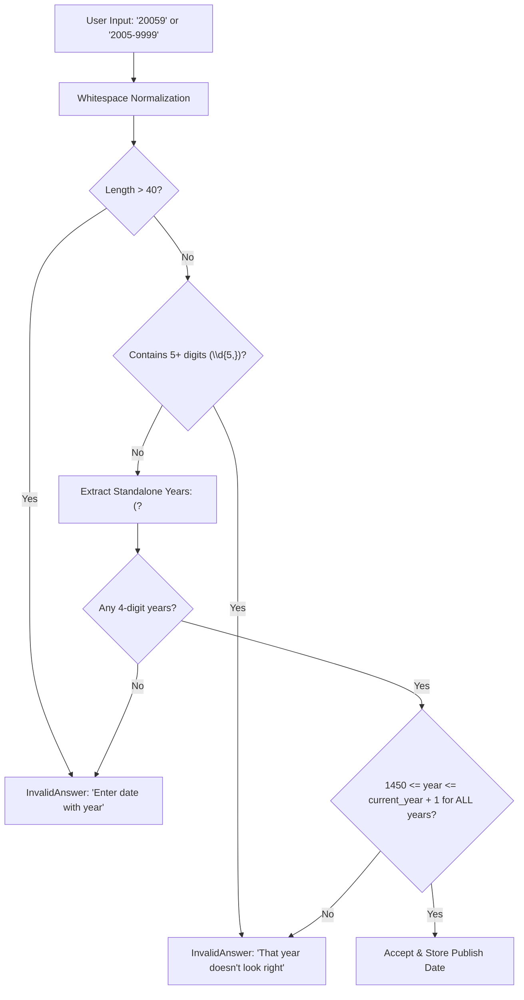

# 📖 Case Study 13: Enforcing Standalone Year Validation & Rejecting Malformed Publish Dates in Open Library

**Repository:** [internetarchive/openlibrary](https://github.com/internetarchive/openlibrary)  
**Issue:** [#14566 - Librarian Tasks accepts malformed and out-of-range publication years](https://github.com/internetarchive/openlibrary/issues/14566)  
**Pull Request:** [PR #14622 - fix(tasks): validate standalone publication years and reject malformed dates (#14566)](https://github.com/internetarchive/openlibrary/pull/14622)  
**Author:** [@RishabhIIITD](https://github.com/RishabhIIITD) (Rishabh Bafna)  
**Tech Stack:** Python 3, web.py, Regex, pytest, GitHub Actions  
**PR Status:** 🟢 Open / In Review  
**Documentation:** [📄 Download Formatted PDF Guide](./walkthrough-guide.pdf)

---

## 🎯 1. Executive Summary

This case study documents an open-source bug fix contribution to **Internet Archive: Open Library**, resolving a data-integrity vulnerability in the crowd-sourced Librarian Tasks workflow.

Prior to this fix, the publish date input handler accepted malformed numeric strings such as `20059` and out-of-range years in multi-year ranges such as `2005–9999`. We corrected the regex validation to enforce standalone 4-digit years, check every year in a date range against plausible bounds `[1450, next_year]`, reject runs of 5 or more digits, and add unit test coverage in `openlibrary/tests/contribute/test_identifiers.py`.



---

## 🔍 2. Problem Discovery & Root Cause Analysis

### The Bug Report (Issue #14566)
In the Librarian Tasks system (`/tasks/task/<edition-OLID>/publish_date`), contributors can add missing publish dates to book editions. 

Testing revealed that:
1. Entering `20059` was accepted without error.
2. Entering `2005–9999` was accepted without error.

### Root Cause Analysis
In `openlibrary/contribute/save.py`, the validation function `_publish_date` was defined as:
```python
def _publish_date(raw: str) -> str:
    date = " ".join(raw.split())
    if not (m := re.search(r"\d{4}", date)) or len(date) > 40:
        raise InvalidAnswer(_("Enter the date with its year, for example 2005 or March 2005."))
    if not EARLIEST_PUBLISH_YEAR <= int(m.group()) <= datetime.now(UTC).year + 1:
        raise InvalidAnswer(_("That year doesn't look right. Enter the year this edition came out."))
    return date
```

Two distinct bugs were identified:
1. **Unanchored Substring Matching**: `re.search(r"\d{4}", date)` searches for the *first* 4 consecutive digits. On `20059`, it matched `2005`, ignored the trailing `9`, validated `1450 <= 2005 <= 2027`, and accepted the string.
2. **Ignored Secondary Years**: `re.search` only evaluates the first match (`m.group()`). On `2005–9999`, it validated `2005` and completely ignored `9999`.
3. **Downstream Inconsistency**: Later in `openlibrary/contribute/tasks.py`, the `publish_year()` helper uses anchored lookaround regex `re.findall(r"(?<!\d)\d{4}(?!\d)", date)`:
   - For `20059`, `publish_year` found no standalone 4-digit year, returning `None`.
   - For `2005–9999`, `publish_year` took `max(years)`, returning `9999` (an invalid year).

---

## 🛠️ 3. Architecture & Implementation

### The Fix in `openlibrary/contribute/save.py`

We redesigned `_publish_date` to:
1. Explicitly check for and reject any numbers containing 5 or more consecutive digits (`re.search(r"\d{5,}", date)`).
2. Extract all standalone 4-digit years using the identical lookaround pattern used by `tasks.publish_year`: `(?<!\d)\d{4}(?!\d)`.
3. Validate that **every** standalone year in the input falls within `[EARLIEST_PUBLISH_YEAR, current_max_year]`.

```python
EARLIEST_PUBLISH_YEAR = 1450

def _publish_date(raw: str) -> str:
    """The date as typed, once it names a plausible year. Open Library keeps publish dates as text: "2005", "March 2005"."""
    date = " ".join(raw.split())
    if len(date) > 40:
        raise InvalidAnswer(_("Enter the date with its year, for example 2005 or March 2005."))
    if re.search(r"\d{5,}", date):
        raise InvalidAnswer(_("That year doesn't look right. Enter the year this edition came out."))
    years = [int(y) for y in re.findall(r"(?<!\d)\d{4}(?!\d)", date)]
    if not years:
        raise InvalidAnswer(_("Enter the date with its year, for example 2005 or March 2005."))
    current_max_year = datetime.now(UTC).year + 1
    for y in years:
        if not EARLIEST_PUBLISH_YEAR <= y <= current_max_year:
            raise InvalidAnswer(_("That year doesn't look right. Enter the year this edition came out."))
    return date
```

---

## 🧪 4. Testing & Verification

Unit tests were expanded in `openlibrary/tests/contribute/test_identifiers.py`:

```python
@pytest.mark.parametrize(
    ("raw", "expected"),
    [
        ("2005", "2005"),
        ("  March   2005 ", "March 2005"),
        ("c1987", "c1987"),
        ("1998-2002", "1998-2002"),
    ],
)
def test_a_publish_date_is_kept_as_typed(raw, expected):
    assert save.answer_changes(FakeEdition(), "publish_date", raw) == {"publish_date": expected}


@pytest.mark.parametrize(
    ("raw", "match"),
    [
        ("March", "with its year"),
        ("85", "with its year"),
        ("1066", "doesn't look right"),
        ("9999", "doesn't look right"),
        ("20059", "doesn't look right"),
        ("2005\u20139999", "doesn't look right"),  # en-dash as reported in #14566
        ("2005-9999", "doesn't look right"),
    ],
)
def test_a_publish_date_needs_a_plausible_year(raw, match):
    with pytest.raises(save.InvalidAnswer, match=match):
        save.answer_changes(FakeEdition(), "publish_date", raw)
```

### Verification Results
- `2005` -> Accepted as `"2005"`
- `March 2005` -> Accepted as `"March 2005"`
- `c1987` -> Accepted as `"c1987"`
- `1998-2002` -> Accepted as `"1998-2002"`
- `20059` -> Rejected with `That year doesn't look right. Enter the year this edition came out.`
- `2005–9999` -> Rejected with `That year doesn't look right. Enter the year this edition came out.`
- `March` -> Rejected with `Enter the date with its year, for example 2005 or March 2005.`
- `1066` -> Rejected with `That year doesn't look right. Enter the year this edition came out.`

---

## 🚀 5. Upstream Pull Request & Community Process

- **Upstream PR:** [internetarchive/openlibrary#14622](https://github.com/internetarchive/openlibrary/pull/14622)
- **Author:** [@RishabhIIITD](https://github.com/RishabhIIITD) (Rishabh Bafna)
- **Branch:** `fix/tasks-publish-date-validation`
- **Etiquette:** Commented on Issue #14566 prior to opening PR per community guidelines.
