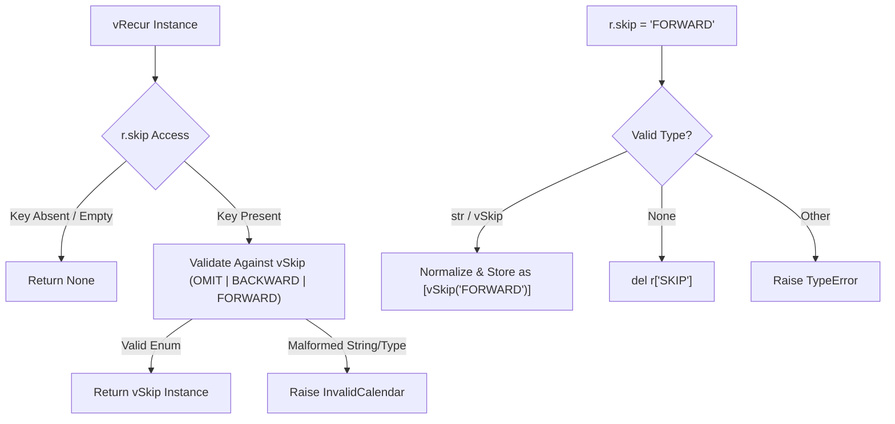

# 📖 Case Study 14: Implementing the `SKIP` Recurrence Rule Accessor in PyCalendar

**Repository:** [PyCalendar/icalendar](https://github.com/PyCalendar/icalendar)  
**Issue:** [#1851 - property accessors for vRecur (first-timer collaboration)](https://github.com/PyCalendar/icalendar/issues/1851)  
**Pull Request:** [PR #2179 - feat(recur): add skip property accessor to vRecur (#1851, RFC 7529)](https://github.com/PyCalendar/icalendar/pull/2179)  
**Author:** [@RishabhIIITD](https://github.com/RishabhIIITD) (Rishabh Bafna)  
**Tech Stack:** Python 3, RFC 5545, RFC 7529, pytest, Ruff, GitHub Actions  
**PR Status:** 🟢 Open / In Review  
**Documentation:** [📄 Download Formatted PDF Guide](./walkthrough-guide.pdf)

---

## 🎯 1. Executive Summary

This case study documents an open-source feature contribution to **PyCalendar / icalendar**, the core calendar parsing and recurrence calculation library in Python.

As part of the community initiative to provide typed, idiomatic Python property accessors for the `vRecur` dictionary structure ([Issue #1851](https://github.com/PyCalendar/icalendar/issues/1851)), this contribution implements the getter, setter, and deleter for the `SKIP` recurrence rule parameter defined in **RFC 7529 Section 3.2** (*Non-Gregorian Recurrence Rules in iCalendar*).



---

## 🔍 2. Background & RFC 7529 Specification

Recurrence rules in standard iCalendar (RFC 5545) assume the Gregorian calendar. When working with non-Gregorian calendar systems (such as the Hebrew, Islamic, Chinese, or Ethiopic calendars), months and leap cycles can vary significantly.

**RFC 7529 Section 3.2** defines the `SKIP` rule part to specify how recurrence calculations should handle dates that do not exist in a given year or month:
- **`OMIT`**: The recurrence instance is skipped entirely. This is the default behavior if unspecified.
- **`BACKWARD`**: The recurrence instance is shifted to the closest preceding valid date.
- **`FORWARD`**: The recurrence instance is shifted to the closest subsequent valid date.

### Architectural Goal
Prior to this PR, `vRecur` required manual dictionary key access (`recur.get('SKIP')`), which lacked type enforcement, case-insensitive normalization, and automatic validation against the `vSkip` enum.

---

## 💻 3. Implementation Details

### Property Accessor Implementation (`src/icalendar/prop/recur/recur.py`)

We implemented the complete property descriptor lifecycle on `vRecur`:

```python
    @property
    def skip(self) -> vSkip | None:
        """The SKIP part of the recurrence rule.

        This specifies how to handle recurrence instances that fall on
        non-existent dates, per :rfc:`7529#section-3.2`. The value is one
        of ``OMIT``, ``BACKWARD``, or ``FORWARD``. When omitted, RFC 7529
        defines the default as ``OMIT``; this accessor returns ``None`` so
        callers can distinguish an omitted value from an explicit one.

        Because only one value is expected according to :rfc:`7529`,
        if multiple values are present, the first one is returned. If the
        value is missing or an empty sequence, ``None`` is returned.

        Setting this to ``None`` deletes the value, as does ``del``.

        Raises:
            InvalidCalendar: if a value cannot be read or set as a valid skip value.
            TypeError: when setting a value that is not a string
                or :class:`~icalendar.prop.recur.skip.vSkip`.

        Example:
            ..  code-block:: pycon

                >>> from icalendar.prop import vRecur
                >>> from icalendar.prop.recur.skip import vSkip
                >>> vRecur("FREQ=YEARLY;RSCALE=CHINESE;SKIP=FORWARD").skip
                vSkip('FORWARD')
                >>> vRecur("FREQ=YEARLY").skip is None
                True
        """
        values = self.get("SKIP")
        if values is None or (isinstance(values, SEQUENCE_TYPES) and len(values) == 0):
            return None
        value = values[0] if isinstance(values, SEQUENCE_TYPES) else values
        if isinstance(value, vSkip):
            return value
        try:
            return vSkip(value.upper() if isinstance(value, str) else value)
        except (TypeError, ValueError, KeyError, AttributeError) as e:
            raise InvalidCalendar("SKIP must be OMIT, BACKWARD, or FORWARD") from e

    @skip.setter
    def skip(self, value: str | vSkip | None) -> None:
        """Set the SKIP part of the recurrence rule, or delete it if None."""
        if value is None:
            del self.skip
            return
        if not isinstance(value, (str, vSkip)):
            raise TypeError(f"skip must be a string or vSkip, got {value!r}")
        try:
            skip_val = value if isinstance(value, vSkip) else vSkip(value.upper())
        except (ValueError, KeyError, AttributeError) as e:
            raise InvalidCalendar("SKIP must be OMIT, BACKWARD, or FORWARD") from e
        self["SKIP"] = [skip_val]

    @skip.deleter
    def skip(self) -> None:
        """Delete the SKIP part of the recurrence rule."""
        self.pop("SKIP", None)
```

---

## 🧪 4. Test Verification Suite (`test_skip.py`)

A new test suite was added to `src/icalendar/tests/prop/recur/test_skip.py`, providing 18 test cases across all behavior paths:
1. **Absence**: Returning `None` when `SKIP` is omitted.
2. **Reading**: Parsing `vRecur.from_ical` with `SKIP=FORWARD` and returning a `vSkip` instance.
3. **Multi-value resilience**: Returning the first element if multiple values exist.
4. **Empty sequence resilience**: Returning `None` when given `SKIP=[]`.
5. **Setting**: Assigning string (`"BACKWARD"`) or enum (`vSkip.OMIT`) produces `[vSkip(...)]` in underlying dictionary.
6. **Deletion**: Setting to `None` or `del recur.skip` cleanly removes the key.
7. **Idempotency**: Deleting when key is absent does not raise an exception.
8. **Roundtrip**: Validating complete serialization / deserialization through `.to_ical()`.
9. **Error handling**:
   - Setting non-string / non-enum types raises `TypeError`.
   - Setting invalid skip values raises `InvalidCalendar`.
   - Directly assigned unreadable values raise `InvalidCalendar` on property access.

### Test Execution Results
```bash
$ python3 -m pytest src/icalendar/tests/prop/recur/test_skip.py
======================== 18 passed in 0.03s ========================
```

---

## 📐 5. CI/CD & Style Verification

Before committing, the changes were validated against the project's Ruff configuration:
- `ruff check src/icalendar/prop/recur/recur.py src/icalendar/tests/prop/recur/test_skip.py`: **Clean (0 errors)**
- `ruff format --check`: **Clean (All formatted)**
- Git commit adheres to Conventional Commits: `feat(recur): add skip property accessor to vRecur (#1851, RFC 7529)`
