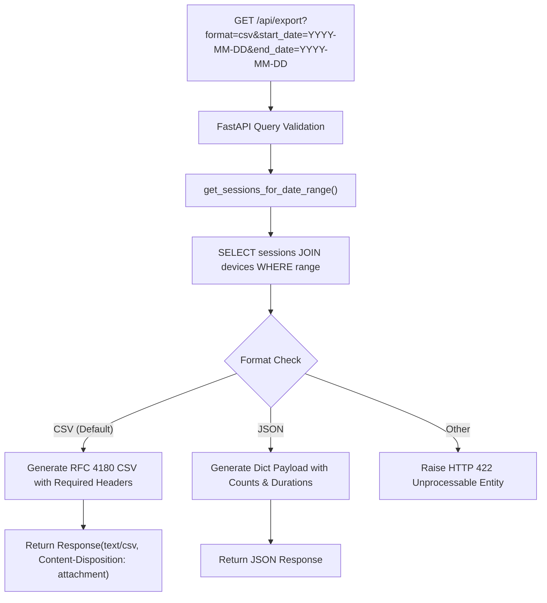

# 📖 Case Study 15: Implementing CSV and JSON Session Export Endpoints in OmniScreen

**Repository:** [aditya8242/omniscreen-agent](https://github.com/aditya8242/omniscreen-agent)  
**Issue:** [#3 - Add CSV and JSON export endpoint for screen time session history](https://github.com/aditya8242/omniscreen-agent/issues/3)  
**Pull Request:** [PR #4 - feat(hub): add CSV and JSON export endpoint for session history (#3)](https://github.com/aditya8242/omniscreen-agent/pull/4)  
**Author:** [@RishabhIIITD](https://github.com/RishabhIIITD) (Rishabh Bafna)  
**Tech Stack:** Python 3, FastAPI, SQLite (WAL mode), pytest, GitHub Actions  
**PR Status:** 🟢 Open / In Review  
**Documentation:** [📄 Download Formatted PDF Guide](./walkthrough-guide.pdf)

---

## 🎯 1. Executive Summary

This case study documents an open-source backend feature contribution to **OmniScreen Reality Hub**, a local-first cross-device screen time intelligence platform designed with zero cloud telemetry and exact interval union mathematics.

To empower users with full ownership and portability of their raw timeline data, this contribution implements the session export API ([Issue #3](https://github.com/aditya8242/omniscreen-agent/issues/3)), providing formatted CSV and JSON downloads with optional date-range filtering.



---

## 🔍 2. Background & Problem Statement

OmniScreen records active app usage intervals `[start_ts, end_ts]` in a local SQLite database (`omniscreen.db`). While the desktop dashboard renders graphical exposure metrics and reality summaries, users lacked a straightforward mechanism to export their historical raw sessions for:
1. Personal data backup and spreadsheets (Excel / Google Sheets / Numbers).
2. Data science research, productivity analytics, or custom automation pipelines.
3. Offline data portability without cloud dependencies.

### Core Architecture Constraints
1. **Zero External Cloud Telemetry**: All export logic must execute entirely in-process using standard library modules (`csv`, `json`, `io.StringIO`).
2. **Local Privacy Guarantees**: Querying must remain bounded and non-destructive.
3. **Exact Time Representation**: Timestamps must be preserved both in exact UNIX seconds and human-readable ISO 8601 formats (`YYYY-MM-DDTHH:MM:SS`), with duration computed as discrete seconds.

---

## 💻 3. Implementation Details

### Database Range Querying (`hub/database.py`)
We implemented `get_sessions_for_date_range()` in `hub/database.py` with parameterized boundary queries:

```python
def get_sessions_for_date_range(
    start_date: Optional[str] = None,
    end_date: Optional[str] = None,
    db_path: Optional[str] = None
) -> List[Dict[str, Any]]:
    """
    Fetch all recorded sessions across devices within an optional [start_date, end_date] range.
    Dates are formatted as 'YYYY-MM-DD'. If omitted, queries all available history.
    """
    conn = get_connection(db_path)
    try:
        cur = conn.cursor()
        query = """
            SELECT s.id, s.device_id, s.device_type, d.device_name, s.start_ts, s.end_ts, s.app_name, s.category
            FROM sessions s
            LEFT JOIN devices d ON s.device_id = d.device_id
        """
        conditions = []
        params = []

        if start_date:
            dt_start = datetime.strptime(start_date, "%Y-%m-%d")
            start_ts = datetime(dt_start.year, dt_start.month, dt_start.day, 0, 0, 0).timestamp()
            conditions.append("s.end_ts >= ?")
            params.append(start_ts)

        if end_date:
            dt_end = datetime.strptime(end_date, "%Y-%m-%d")
            end_ts = datetime(dt_end.year, dt_end.month, dt_end.day, 23, 59, 59, 999999).timestamp()
            conditions.append("s.start_ts <= ?")
            params.append(end_ts)

        if conditions:
            query += " WHERE " + " AND ".join(conditions)

        query += " ORDER BY s.start_ts ASC"

        cur.execute(query, tuple(params))
        results = []
        for row in cur.fetchall():
            results.append({
                "id": row["id"],
                "device_id": row["device_id"],
                "device_type": row["device_type"],
                "device_name": row["device_name"] or row["device_id"],
                "start_ts": row["start_ts"],
                "end_ts": row["end_ts"],
                "app_name": row["app_name"],
                "category": row["category"]
            })
        return results
    finally:
        conn.close()
```

### API Endpoint (`hub/server.py`)
We implemented the `GET /api/export` route:

```python
@app.get("/api/export")
def export_sessions(
    format: str = Query("csv", pattern=r"^(?i)(csv|json)$"),
    start_date: Optional[str] = Query(None, pattern=r"^\d{4}-\d{2}-\d{2}$"),
    end_date: Optional[str] = Query(None, pattern=r"^\d{4}-\d{2}-\d{2}$"),
):
    """
    Export raw screen time session records as CSV or JSON.
    Allows filtering by an optional [start_date, end_date] window.
    """
    try:
        sessions = get_sessions_for_date_range(start_date=start_date, end_date=end_date)
        fmt = format.lower()

        if fmt == "csv":
            output = io.StringIO()
            writer = csv.writer(output)
            writer.writerow([
                "device_id",
                "device_name",
                "device_type",
                "app_name",
                "start_time",
                "end_time",
                "duration_seconds",
            ])
            for s in sessions:
                start_iso = datetime.fromtimestamp(s["start_ts"]).isoformat()
                end_iso = datetime.fromtimestamp(s["end_ts"]).isoformat()
                duration = round(s["end_ts"] - s["start_ts"], 2)
                writer.writerow([
                    s["device_id"],
                    s["device_name"],
                    s["device_type"],
                    s["app_name"],
                    start_iso,
                    end_iso,
                    duration,
                ])

            filename = f"omniscreen_sessions_{start_date or 'all'}_to_{end_date or 'all'}.csv"
            return Response(
                content=output.getvalue(),
                media_type="text/csv",
                headers={"Content-Disposition": f'attachment; filename="{filename}"'}
            )

        elif fmt == "json":
            export_data = []
            for s in sessions:
                start_iso = datetime.fromtimestamp(s["start_ts"]).isoformat()
                end_iso = datetime.fromtimestamp(s["end_ts"]).isoformat()
                duration = round(s["end_ts"] - s["start_ts"], 2)
                export_data.append({
                    "id": s["id"],
                    "device_id": s["device_id"],
                    "device_name": s["device_name"],
                    "device_type": s["device_type"],
                    "app_name": s["app_name"],
                    "category": s["category"],
                    "start_ts": s["start_ts"],
                    "end_ts": s["end_ts"],
                    "start_time": start_iso,
                    "end_time": end_iso,
                    "duration_seconds": duration,
                })
            return {
                "sessions": export_data,
                "count": len(export_data),
                "start_date": start_date,
                "end_date": end_date,
            }
        else:
            raise HTTPException(status_code=400, detail="Invalid export format. Supported formats: csv, json")
    except HTTPException:
        raise
    except Exception as e:
        raise HTTPException(status_code=500, detail=f"Failed to export session records: {str(e)}")
```

---

## 🧪 4. Testing & Verification

Comprehensive automated tests were authored in both database and API test suites:
- `tests/test_database.py`:
  - `test_database_get_sessions_for_date_range`: Verifies multi-day insertion, unbounded querying, inclusive boundary filtering (`start_date="2024-11-15"`, `end_date="2024-11-16"`), and device friendly-name fallback.
- `tests/test_api.py`:
  - `test_api_export_csv_and_json`:
    - Validates CSV header format and row column values.
    - Validates JSON output structure, record count, and calculated duration.
    - Validates empty response on out-of-range date filter.
    - Validates regex-enforced 422 on unsupported format parameters.

### Test Execution Results
```bash
$ python3 -m pytest tests/ -v
============================== 24 passed in 1.48s ==============================
```

---

## 📐 5. Key Engineering Takeaways

1. **Standardized Column Order**: Formatting CSV headers explicitly (`device_id,device_name,device_type,app_name,start_time,end_time,duration_seconds`) ensures seamless third-party ingestion into tools like Pandas, DuckDB, or Excel.
2. **Streaming via `io.StringIO`**: Generating the CSV in memory avoids temporary file clutter on the host machine while streaming the payload cleanly via FastAPI's `Response`.
3. **Safe Parameterized Queries**: Constructing dynamic SQL queries with parameterized tuples (`?`) eliminates SQL injection vulnerabilities while supporting arbitrary date combinations.
